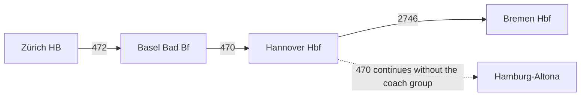

# Kurswagen (Direct carriage)

## Overview

A **Kurswagen** (direct carriage) is a coach group that is pulled by different trains
on different sections of its route. A passenger stays seated in the coach group from
its first to its last stop and books exactly this journey; the pulling trains are
separate journeys in their own right.

**Example used in this use case:** direct carriage 37 Zürich HB – Bremen Hbf, taken
from the direct-carriage example of the SKI HRDF realisation guide (section 7.1.4).
The coach group is pulled by train 472 (Zürich HB – Basel Bad Bf), train 470
(Basel Bad Bf – Hannover Hbf) and train 2746 (Hannover Hbf – Bremen Hbf). Train 470
continues to Hamburg-Altona after the coach group has been detached.



## Mapping between HRDF and NeTEx

| HRDF | NeTEx RG1 | NeTEx RG2 | Use Case |
|------|-----------|-----------|----------|
| `*KW` / `*KWZ` | – | `ServiceJourney` for the coach group with one `JourneyPart` (`PurposeOfJourneyPartition:DirectCarriage`) per `*KWZ` | Direct carriage |
| Attribute `KW` ("Direkter Wagen") | – | `Notice` assigned to the `ServiceJourney` of the coach group (see [mapping excel](./media/Mappingtabellen_NeTEx_v2.0.xlsx), sheet *Angebote*) | Passenger-facing marker |

In HRDF, `*KW` carries the number of the direct carriage. Each section follows as a
`*KWZ` line with the train number of the pulling train and the from and to stations:

```
*KW  000037
*KWZ 000472 80____ Zuerich HB    - Basel Bad Bf   02215 02319
*KWZ 000470 80____ Basel Bad Bf  - Hannover Hbf   02340 00612
*KWZ 002746 80____ Hannover Hbf  - Bremen Hbf     00644 00754
```

## Modelling with NeTEx RG 2.0 (`JourneyPart`)

Direct carriages are modelled with `JourneyPart`. The general rules for `JourneyPart`
are described in [uc05 Journey Parts](uc05_journey_parts.md).

- The coach group is one complete `ServiceJourney` from its first to its last stop.
  It has its own `ServiceJourneyPattern` over the whole path, its own
  `TimeDemandType` (the wait times are the handover dwells) and its own `Line`,
  because `RouteView/LineRef` is mandatory on `ServiceJourneyPattern`.
- Each pulling train is a `ServiceJourney` of its own, with its own
  `ServiceJourneyPattern`.
- The `ServiceJourney` of the coach group contains one `JourneyPart` per pulling
  train, i.e. one per `*KWZ`:
  - `ParentJourneyRef` references the `ServiceJourney` of the pulling train.
  - `FromPointInPatternRef` / `ToPointInPatternRef` delimit the section within the
    `ServiceJourneyPattern` of the pulling train. This can be a sub-range: train 470
    has three points (Basel Bad Bf, Hannover Hbf, Hamburg-Altona), the coach group
    only rides points 1 to 2.
  - `TrainNumberRef` is the train number of the pulling train.
  - `StartTime` / `EndTime` with the day offsets give the time bounds of the section.
  - `PurposeOfJourneyPartitionRef` is `ch:1:PurposeOfJourneyPartition:DirectCarriage`.
- The coach group has no train number of its own. Its `trainNumbers` list the
  `TrainNumber`s of the pulling trains in the order of the sections. The number of
  the direct carriage from `*KW` is **not** a `TrainNumber`: a `TrainNumber` is the
  number from `*Z` (see [TrainNumber template](./templates/TrainNumber.xml)).
- `JourneyPartCouple` and `ServiceJourneyInterchange` are **not used** for direct
  carriages. `ParentJourneyRef` together with the two `PointInPattern` references
  already states which train pulls which section.

```xml
<ServiceJourney id="ch:1:ServiceJourney:KW37" version="1" responsibilitySetRef="ch:1:ResponsibilitySet:DB">
  <!-- ... -->
  <noticeAssignments>
    <NoticeAssignment id="ch:1:NoticeAssignment:KW37:1" version="1">
      <NoticeRef ref="ch:1:Notice:A__KW" version="1"/>
    </NoticeAssignment>
  </noticeAssignments>
  <ServiceAlteration>planned</ServiceAlteration>
  <DepartureTime>22:15:00</DepartureTime>
  <DepartureDayOffset>0</DepartureDayOffset>
  <ServiceJourneyPatternRef ref="ch:1:ServiceJourneyPattern:KW37" version="1"/>
  <TimeDemandTypeRef ref="ch:1:TimeDemandType:KW37" version="1"/>
  <OperatorRef ref="ch:1:sboid:100310" version="1"/>
  <trainNumbers>
    <TrainNumberRef ref="ch:1:TrainNumber:472" version="1"/>
    <TrainNumberRef ref="ch:1:TrainNumber:470" version="1"/>
    <TrainNumberRef ref="ch:1:TrainNumber:2746" version="1"/>
  </trainNumbers>
  <!-- ... -->
  <parts>
    <JourneyPart id="ch:1:JourneyPart:KW37:1" version="1">
      <Description lang="de">Kurswagen 37 am Zug 472, Zürich HB - Basel Bad Bf</Description>
      <ParentJourneyRef ref="ch:1:ServiceJourney:472" version="1"/>
      <TrainNumberRef ref="ch:1:TrainNumber:472" version="1"/>
      <FromPointInPatternRef ref="ch:1:ServiceJourneyPattern:472:1" version="1"/>
      <ToPointInPatternRef ref="ch:1:ServiceJourneyPattern:472:2" version="1"/>
      <StartTime>22:15:00</StartTime>
      <StartTimeDayOffset>0</StartTimeDayOffset>
      <EndTime>23:19:00</EndTime>
      <EndTimeDayOffset>0</EndTimeDayOffset>
      <PurposeOfJourneyPartitionRef ref="ch:1:PurposeOfJourneyPartition:DirectCarriage" version="1"/>
    </JourneyPart>
    <!-- 470 continues to Hamburg-Altona; the coach leaves it at Hannover Hbf,
         so this part ends at point 2 of 3. -->
    <JourneyPart id="ch:1:JourneyPart:KW37:2" version="1">
      <Description lang="de">Kurswagen 37 am Zug 470, Basel Bad Bf - Hannover Hbf</Description>
      <ParentJourneyRef ref="ch:1:ServiceJourney:470" version="1"/>
      <TrainNumberRef ref="ch:1:TrainNumber:470" version="1"/>
      <FromPointInPatternRef ref="ch:1:ServiceJourneyPattern:470:1" version="1"/>
      <ToPointInPatternRef ref="ch:1:ServiceJourneyPattern:470:2" version="1"/>
      <StartTime>23:40:00</StartTime>
      <StartTimeDayOffset>0</StartTimeDayOffset>
      <EndTime>06:12:00</EndTime>
      <EndTimeDayOffset>1</EndTimeDayOffset>
      <PurposeOfJourneyPartitionRef ref="ch:1:PurposeOfJourneyPartition:DirectCarriage" version="1"/>
    </JourneyPart>
    <JourneyPart id="ch:1:JourneyPart:KW37:3" version="1">
      <Description lang="de">Kurswagen 37 am Zug 2746, Hannover Hbf - Bremen Hbf</Description>
      <ParentJourneyRef ref="ch:1:ServiceJourney:2746" version="1"/>
      <TrainNumberRef ref="ch:1:TrainNumber:2746" version="1"/>
      <FromPointInPatternRef ref="ch:1:ServiceJourneyPattern:2746:1" version="1"/>
      <ToPointInPatternRef ref="ch:1:ServiceJourneyPattern:2746:2" version="1"/>
      <StartTime>06:44:00</StartTime>
      <StartTimeDayOffset>1</StartTimeDayOffset>
      <EndTime>07:54:00</EndTime>
      <EndTimeDayOffset>1</EndTimeDayOffset>
      <PurposeOfJourneyPartitionRef ref="ch:1:PurposeOfJourneyPartition:DirectCarriage" version="1"/>
    </JourneyPart>
  </parts>
</ServiceJourney>
```

- [Full example: direct carriage 37 Zürich HB – Bremen Hbf](./examples/21_NeTEx_CH_Kurswagen_Zuerich_Bremen.xml)

## Related use cases

- [uc01 Durchbindung](uc01_durchbindung.md)
- [uc02 Joining and splitting of trains](uc02_joining_splitting.md)
- [uc05 Journey Parts](uc05_journey_parts.md)
- [uc15 Formations](uc15_formations.md)
