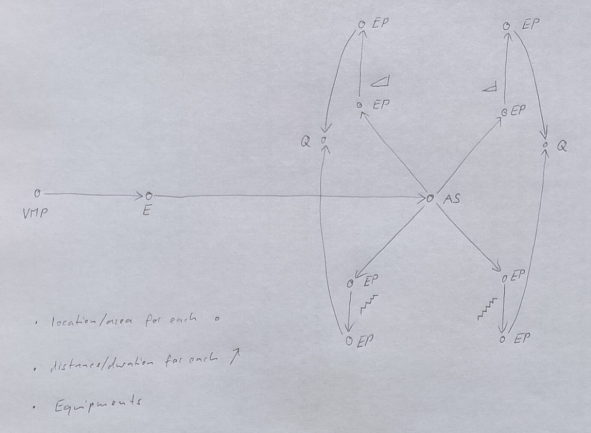
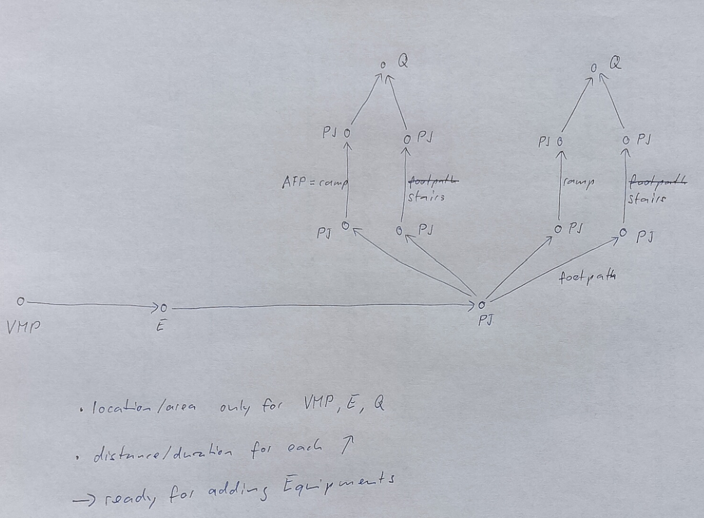
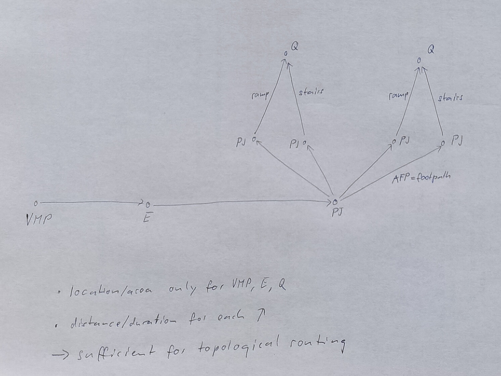

# Accessibility

Definition of the Swiss Accessibility Profile.

**Current State**
- Elaborated only for Site elements
- Does not fully obey the EPIAP philosophy of favoring Equipments over Facilities and Services. 


**Future Developments**
- Alignment with upcoming ERA TSI/PRM definitions
- Accessibility for vehicles, journeys
- We may add SitePathLinks
- We may add StairEquipment, RampEquipment, etc. 
- Granularity of navigation networks? - First thoughts  [presented below](#sitepathlink).

---

**In this chapter**:

AccessibilityAssessment
- [**AccessibilityAssessment**](#accessibilityassessment)

Basic Orientation
- **Level**
- [**StopPlaceEntrance**](#stopplaceentrance)
- [**StopPlace - the Additional Elements**](#stopplace---the-additional-elements)
- [**Quay - the Additional Elements**](#quay---the-additional-elements)
- *AccessSpace - not used*


PrivateMobility
- **Parking -** [**see StopPlace**](#stopplace---the-additional-elements)

Path Navigation
- [**SitePathLink**](#sitepathlink) - *not used*
- *PathJunction - not used*


Equipments, Facilities & Services
- [**SiteFacilitySet - the Additional Elements**](#sitefacilityset---the-additional-elements)
- [**AssistanceService**](#assistanceservice)
- [**AssistanceBookingService**](#assistancebookingservice)
- **SanitaryEquipment -** [**see StopPlace**](#stopplace---the-additional-elements)
- **TicketingEquipment -** [**see StopPlace**](#stopplace---the-additional-elements)
- *EquipmentPlace - not used*
- *EntranceEquipment - not used*
- *EscalatorEquipment - not used*
- *LiftEquipment - not used*
- *RampEquipment - not used*
- *TravelatorEquipment - not used*
- *SignEquipment - not used*
- *MeetingPointService - not used*
- *CustomerService - not used*
- *ServiceFacilitySet - not used*

Vehicles & Vehicle Stop Interaction
- *VehicleType - not used*
- *BoardingPosition - not used*


## AccessibilityAssessment
*→ [Glossary definition](A4_annex_glossary.md#accessibilityassessment)* 

### Purpose

An assessment of the usability by passengers with specific needs, for example, those needing wheelchair access, step-free access or for the visually or the auditorily impaired.


### Table


*Table: AccessibilityAssessment*

| Sub | Element | Usage | Card | Type | Description | Note |
|-----|---------|-------|------|------|-------------|------|
|  | MobilityImpairedAccess | mandatory | 1..1 | LimitationStatusEnumeration | Summary indication as to whether the component is considered to be accessible or not. | Accessibility. Overall assessment for mobility and sensory impaired users. Allowed values: `true, false, partial, unknown`. `partial` means that AccessibiltyAssessments have to exist at lower levels like Quays or other elements. Some Quays may not be accessible if partial is used on the StopPlace. |
|  | limitations | expected | 0..1 | accessibilityLimitations_RelStructure | The ACCESSIBILITY LIMITATION that apply to component. | Accessibility. AccessibilityLimitations can be omitted if MobilityImpairedaccess is set to true and no additional information needs to be conveyed. |
| + | AccessibilityLimitation | mandatory | 0..* | AccessibilityLimitation_VersionedChildStructure | Assessment of the accessibility of a SITE. | Accessibility. The types of access that are offered to account for mobility and sensory impairments. |
| ++ | WheelchairAccess | mandatory | 1..1 | LimitationStatusEnumeration | Whether a PLACE is wheelchair accessible. | Accessibility. Allowed values: `true, false, partial, unknown`. |
| ++ | StepFreeAccess | expected | 0..1 | LimitationStatusEnumeration | Whether a PLACE has step free access. | Accessibility. If absent the value `unknown` is assumed. Allowed values: `true, false, partial, unknown`. |
| ++ | StairFreeAccess | expected | 0..1 | LimitationStatusEnumeration | Whether a PLACE has stair free access, in comparison with step free access one single step in the route is allowed. +v2.0 | Accessibility. Not mandatory in EPIAP, but very useful for perambulators, assisted wheelchairs, bicycles, heavy luggage. Allowed values: `true, false, partial, unknown`. |
| ++ | RampFreeAccess | expected | 0..1 | LimitationStatusEnumeration | Whether a PLACE has ramp free access. Ramp free isn't necessary absolute. If a ramp is not steep, then a PLACE can still be considered ramp free. | Accessibility. Reachable without steep ramps, stairs, or steps. Allowed values: `true, false, partial, unknown`. |
| ++ | LevelAccessIntoVehicle | expected | 0..1 | LimitationStatusEnumeration | Whether the platform is high enough and gap is small enough for level access into vehicle. At least at a designated wheelchair door position the gap between platform and vehicle floor (of level access vehicle) does not exceed 75 mm measured horizontally and 50 mm measured vertically including sliding step (according to PRM TSI). | Accessibility. Whether the platform is high enough and gap is small enough for level access to vehicle. If absent the value `unknown` is assumed. Allowed values: `true, false, partial, unknown`. |
| ++ | AudibleSignalsAvailable | expected | 0..1 | LimitationStatusEnumeration | Whether a PLACE has audible signals for the visually impaired. | Accessibility. If absent the value `unknown` is assumed. Allowed values: `true, false, partial, unknown`. |
| ++ | VisualSignsAvailable | expected | 0..1 | LimitationStatusEnumeration | Whether a PLACE has visual signals for the hearing impaired. | Accessibility. If absent the value `unknown` is assumed. Allowed values: `true, false, partial, unknown`. |
| ++ | TactileGuidanceAvailable | expected | 0..1 | LimitationStatusEnumeration | Whether a PLACE has tactile guidance. | Accessibility. Whether the object has tactileGuidance (for the visually impaired). If absent the value `unknown` is assumed. Allowed values: `true, false, partial, unknown`. |
| ++ | GuideDogAccess | expected | 0..1 | LimitationStatusEnumeration | Whether a PLACE allows guide dog access. | Accessibility. If absent the value `unknown` is assumed. Allowed values: `true, false, partial, unknown`. |


*→ [General NeTEx definition ](../xcore/netex/elements/AccessibilityAssessment.html)*

### Example


```xml
<?xml version="1.0" encoding="UTF-8"?>
<AccessibilityAssessment id="generated" version="1">
  <MobilityImpairedAccess>true
    <!-- Accessibility. Overall assessment for mobility and sensory impaired users. Allowed values: `true, false, partial, unknown`. `partial` means that AccessibiltyAssessments have to exist at lower levels like Quays or other elements. Some Quays may not be accessible if partial is used on the StopPlace. -->
  </MobilityImpairedAccess>
  <limitations>
    <!-- Accessibility. AccessibilityLimitations can be omitted if MobilityImpairedaccess is set to true and no additional information needs to be conveyed. -->
    <AccessibilityLimitation>
      <!-- Accessibility. The types of access that are offered to account for mobility and sensory impairments. -->
      <WheelchairAccess>true
        <!-- Accessibility. Allowed values: `true, false, partial, unknown`. -->
      </WheelchairAccess>
      <StepFreeAccess>true
        <!-- Accessibility. If absent the value `unknown` is assumed. Allowed values: `true, false, partial, unknown`. -->
      </StepFreeAccess>
      <StairFreeAccess>true
        <!-- Accessibility. Not mandatory in EPIAP, but very useful for perambulators, assisted wheelchairs, bicycles, heavy luggage. Allowed values: `true, false, partial, unknown`. -->
      </StairFreeAccess>
      <RampFreeAccess>true
        <!-- Accessibility. Reachable without steep ramps, stairs, or steps. Allowed values: `true, false, partial, unknown`. -->
      </RampFreeAccess>
      <LevelAccessIntoVehicle>true
        <!-- Accessibility. Whether the platform is high enough and gap is small enough for level access to vehicle. If absent the value `unknown` is assumed. Allowed values: `true, false, partial, unknown`. -->
      </LevelAccessIntoVehicle>
      <AudibleSignalsAvailable>true
        <!-- Accessibility. If absent the value `unknown` is assumed. Allowed values: `true, false, partial, unknown`. -->
      </AudibleSignalsAvailable>
      <VisualSignsAvailable>true
        <!-- Accessibility. If absent the value `unknown` is assumed. Allowed values: `true, false, partial, unknown`. -->
      </VisualSignsAvailable>
      <TactileGuidanceAvailable>true
        <!-- Accessibility. Whether the object has tactileGuidance (for the visually impaired). If absent the value `unknown` is assumed. Allowed values: `true, false, partial, unknown`. -->
      </TactileGuidanceAvailable>
      <GuideDogAccess>true
        <!-- Accessibility. If absent the value `unknown` is assumed. Allowed values: `true, false, partial, unknown`. -->
      </GuideDogAccess>
    </AccessibilityLimitation>
  </limitations>
</AccessibilityAssessment>
```


*→ [Template](./templates/AccessibilityAssessment.xml)*


### Usage Notes

In case of `StopPlace` or `Quay`, EPIAP uses the following interpretation: 
`MobilityImpairedAccess` set to `true` means:
* `WheelchairAccess` `true`
* `StepFreeAccess` `true`
* `VisualSignsAvailable` `true` (only for railway stations)
* `TactileGuidanceAvailable` `true`

#### Interpretation of `AccessibilityLimitation`:

We apply a slightly stricter interpretation than the current version of EPIAP. The information that can be conveyed to the passengers thus becomes more useful and exporting the data to foreign systems is unproblematic. The additional constraints are [marked in brackets].

|                                                 |                                                                                                                                                                                                                                                                                                                                                                                                                                                                                                                                 |
|-------------------------------------------------|---------------------------------------------------------------------------------------------------------------------------------------------------------------------------------------------------------------------------------------------------------------------------------------------------------------------------------------------------------------------------------------------------------------------------------------------------------------------------------------------------------------------------------|
| `WheelchairAccess`                              | 1.    `StepFreeAccess` [including `EscalatorFreeAccess`] from an accessible entrance (see next row).<br>2.    The stop / platform is sufficiently wide to make a turn with a wheelchair when entering / leaving the vehicles that usually stop at this stop / platform (depending on the available / needed tools for entering / leaving the vehicle).<br>3.    If boarding trains requires boarding assistance, onsite assistance is available.                                                                                |
| `StepFreeAccess`                                | 1.    A step-free route is an obstacle-free / barrier free [and `EscalatorFreeAccess`] route that meets the needs of mobility impaired persons. Changes in level are avoided or, when they cannot be avoided, they are bridged via ramps or lifts (compliant with PRM TSI).<br>2.    The platform or stop is accessible without steps from the surrounding area (footpaths).<br><br>A platform which has `StepFreeAccess` without `WheelchairAccess` (==`false`) may be not sufficiently wide to make a turn with a wheelchair. |
| `StairFreeAccess`                               | A stair-free route. Single steps allowed, escalators allowed.                                                                                                                                                                                                                                                                                                                                                                                                                                                                   |
| `LevelAccessIntoVehicle`                        | Whether the platform is high enough and gap is small enough for level access into vehicle.<br><br>At least at a designated wheelchair door position the gap between platform and vehicle floor (of level access vehicle) does not exceed 75 mm measured horizontally and 50 mm measured vertically including sliding step (according to PRM TSI).                                                                                                                                                                               |
| `EscalatorFreeAccess` (not included in profile) | Reachable without using an escalator.                                                                                                                                                                                                                                                                                                                                                                                                                                                                                           |
| `LiftFreeAccess` (not included in profile)      | Reachable without using an elevator.                                                                                                                                                                                                                                                                                                                                                                                                                                                                                            |
| `RampFreeAccess`                                | 1.   Reachable without using a ramp that doesn't fit the [UN Design Considerations](https://www.un.org/esa/socdev/enable/designm/AD2-01.htm) (for instance, because they are too steep or a landing is missing in case of a ramp of more than 10 m).<br>2.    [The route provides `WheelchairAccess`].                                                                         |
| `AudibleSignalsAvailable`                       | Whether audible signals for the visually impaired are present.                                                                                                                                                                                                                                                                                                                                                                                                                                                                  |
| `VisualSignsAvailable`                          | 1.   PRM TSI: visual information as signposting, pictograms and dynamic information. <br>2.    [Largely language independent, also suited for passengers from foreign cultures.]                                                                                                                                                                                                                                                                            |
| `TactileGuidanceAvailable`                      | Whether the object has tactile guidance (for the visually impaired).<br>PRM TSI: obstacle-free route to each Quay for the visually impaired passengers equipped with tactile information.  <br>For bus- and tram stops:  <br>1.  Groundsurfaceindicator (at location first door) and/or full-length guideline (for boarding at all entrances)<br>2.   Tactile guideline or boarding position connected to a (natural) guideline in the environment                                                                              |

#### Remarks `RampFreeAccess`

* Note that `RampFreeAccess` may very well include ramps - provided their slopes are only moderate or they have landing / rest areas.
* `RampFreeAccess`is a stronger form of `WheelchairAccess` excluding steeper slopes.


#### Limitations of AccessibilityAssessment

* If, e.g., `WheelchairAccess` or `StairFreeAccess` requires using a lift, the `AccessibilityAssessment` does not convey this information.
* According to EPIAP definitions, a quay with, e.g., `WheelchairAccess` means that there is at least one entrance from which it is reachable. It may be that `WheelchairAccess` only works from a secondary entrance, not from the main entrance.

Such information can be encoded using `SitePathLink`s and `PathJunction`s that describe a routing network including accessibility and location data.

#### Entrances related to AccessibilityAssessment
* All `AccessibiltyLimitation`s (`StepFreeAccess` etc.) relate to a complete path from an "accessible" `StopPlaceEntrance` with `DroppedKerb=true` and `DropOffPointClose=true`. 


## StopPlaceEntrance
*→ [Glossary definition](A4_annex_glossary.md#StopPlaceEntrance)* 

### Purpose
`StopPlaceEntrance`s, in particular if `DroppedKerbOutside` and `DropOffPointClose` are true, are the reference points from which the accessibility of `Quay`s and other place elements is assessed. 


### Table


StopPlaceEntrance.md


*→ [General NeTEx definition ](../xcore/netex/elements/StopPlaceEntrance.html)*

### Example


StopPlaceEntrance.xml


*→ [Template](./templates/StopPlaceEntrance.xml)*


## StopPlace - the Additional Elements


### Table


*Table: StopPlace*

| Sub | Element | Usage | Card | Type | Description | Note |
|-----|---------|-------|------|------|-------------|------|
|  | [AccessibilityAssessment](./tables/AccessibilityAssessment.md) | expected | 0..1 | AccessibilityAssessment_VersionedChildStructure | Accessibility values associated with LEVEL. | Accessibility. Whether the StopPlace and the Quays are accessible for passengers with different mobility or sensory impairments. |
|  | facilities | expected | 0..1 | siteFacilitySets_RelStructure | Facilities available at SITe. | Facilities available at the stop. |
| + | [SiteFacilitySet](./tables/SiteFacilitySet.md) | expected | 0..* | SiteFacilitySetStructure | Set of enumerated FACILITY values that are relevant to a SITE (names based on TPEG classifications, augmented with UIC etc.). | In particular for accessibility information. |
|  | levels | expected | 0..1 | levels_RelStructure | LEVELs found within SITe. | Mandatory if the StopPlace has more than one level. |
| + | Level | expected | 0..* | Level_VersionStructure | Level of a Building or SITE. | Mandatory if the StopPlace has more than one level. |
|  | entrances | optional | 0..1 | siteEntrances_RelStructure | ENTRANCEs to SPACE. | Reference points that will be exported from ATLAS for ERA TSI PRM. |
| + | [StopPlaceEntrance](./tables/StopPlaceEntrance.md) | mandatory | 0..* | StopPlaceEntrance_VersionStructure | Passenger Entrance to a STOP PLACE. | Currently only the sloid is known, coordinates planned for 2027. From this point all references to accessibility are made in Switzerland. |
|  | placeEquipments | optional | 0..1 | equipments_RelStructure | Items of EQUIPMENT that may be located in an EQUIPMENT PLACE. | Used in exports for all TSI PRM relevant equipments. Especially in the data transmissions for rail to ERA. We only have Equipments and no EquipmentPlaces. |
| + | TicketingEquipment | optional | 0..* | unknown |  | Ticketing equipment. |
| ++ | TicketMachines | expected | 0..1 | boolean | Whether there are ticket machines. | Will be exported from ATLAS for ERA TSI PRM (Billettautomat - "Billettautomat vorhanden"). Mirrored in SiteFacilitySet - ticketMachines. |
| ++ | TicketOffice | expected | 0..1 | boolean | Whether there is a distinct ticket office. | Will be exported from ATLAS for ERA TSI PRM (Schalter present). Mirrored in SiteFacilitySet - ticketOffice. |
| ++ | TicketCounter | optional | 0..1 | boolean | Whether there is a ticket counter. | Will be exported from ATLAS for ERA TSI PRM (Schalter present). We don't distinguish between TicketOffice and TicketCounter. |
| ++ | LowCounterAccess | optional | 0..1 | boolean | Whether there is a low counter for accessibility. | Will be exported from ATLAS for ERA TSI PRM (Schalter - "Rollstuhlzugänglichkeit" or Billettautomat - "Barrierefrei"). Applicable for TicketMachine, TicketOffice, TicketCounter. |
| ++ | InductionLoops | optional | 0..1 | boolean | Whether there are induction loops. | Will be exported from ATLAS for ERA TSI PRM (Schalter - "Induktionsverstärker"). Only applicable for TicketOffice, TicketCounter. |
| ++ | TactileInterfaceAvailable | optional | 0..1 | boolean | Indicates whether there is a tactile interface +v1.1. | Will be exported from ATLAS for ERA TSI PRM (Billettautomat - "Akustische und taktile Ausrüstung"). Only applicable for TicketMachine. |
| ++ | AudioInterfaceAvailable | optional | 0..1 | boolean | Indicates whether there is an accessible audio interface (allowing a use closed eyes). +v1.1 | Will be exported from ATLAS for ERA TSI PRM (Billettautomat - "Akustische und taktile Ausrüstung"). Only applicable for TicketMachine. |
| ++ | WheelchairSuitable | expected | 0..1 | boolean | Indicates whether equipment may be used while seated in a wheelchair. +v1.1 | Will be exported from ATLAS for ERA TSI PRM (Schalter - "Rollstuhlzugänglichkeit" or Billettautomat - "Barrierefrei"). Applicable for TicketMachine, TicketOffice, TicketCounter. |
| + | AccessVehicleEquipment | optional | 0..* | AccessVehicleEquipment_VersionStructure | Specialisation of VEHICLE EQUIPMENT for ACCESS providing information such as low floor, ramp, access area dimensions, etc. | Method to get on the vehicle |
| ++ | Hoist | expected | 0..1 | boolean | VEHICLE has a hoist or lift for wheelchairs. | Will be exported from ATLAS for ERA TSI PRM (Haltekante - "Hilfsmittel für Rollstuhl"). May not be set to true for the StopPlace if there is a Quay unaccessible by wheelchair. |
| ++ | Ramp | expected | 0..1 | boolean | Whether a ramp may be used to access VEHICLE. | Will be exported from ATLAS for ERA TSI PRM (Haltekante - "Hilfsmittel für Rollstuhl"). May not be set to true for the StopPlace if there is a Quay unaccessible by wheelchair. |
| + | SanitaryEquipment | optional | 0..* | unknown |  |  |
| ++ | Name | optional | 0..1 | MultilingualString | Name of EQUIPMENT. |  |
| ++ | [AccessibilityAssessment](./tables/AccessibilityAssessment.md) | optional | 0..1 | AccessibilityAssessment_VersionedChildStructure |  |  |
| ++ | SanitaryFacilityList | mandatory | 0..1 | SanitaryFacilityListOfEnumerations |  | Will be exported from ATLAS for ERA TSI PRM (Toiletten - "Rollstuhlgängige Toilette). Presence or absence of `wheelchairAccessToilet toilet`. Mirrored in SiteFacilitySet - SanitaryFacilityList. |
| ++ | ToiletsType | optional | 0..1 | ToiletsTypeEnumeration | Indicates the position of using the toilet. | Allowed values: `seated urinal seatedAndUrinal squat`. |
|  | localServices | optional | 0..1 | localServices_RelStructure |  | Will be exported from ATLAS for ERA TSI PRM. |
| + | [AssistanceService](./tables/AssistanceService.md) | mandatory | 0..* | AssistanceService_VersionStructure | Specialisation of LOCAL SERVICE for ASSISTANCE providing information like language, accessibility trained staff, etc. | Presence of`AssistanceFacility`s and their availability , e.g., if they need to be booked. |
| + | [AssistanceBookingService](./tables/AssistanceBookingService.md) | optional | 0..* | AssistanceBookingService_VersionStructure | Information about how to book assistance for wheelchair and disabled users. | Accessibility. Contact and booking information regarding assistance services. |


### Example


```xml
<?xml version="1.0" encoding="UTF-8"?>
<StopPlace id="ch:1:sloid:7000" version="1">
  <ValidBetween>
    <FromDate>2025-12-14T00:00:00</FromDate>
    <ToDate>2026-12-12T23:59:59</ToDate>
  </ValidBetween>
  <keyList>
    <KeyValue>
      <Key>HafasPriority</Key>
      <Value>4</Value>
    </KeyValue>
    <KeyValue>
      <Key>HafasKMInfo</Key>
      <Value>1000</Value>
    </KeyValue>
  </keyList>
  <privateCodes>
    <PrivateCode type="didok">7000</PrivateCode>
    <PrivateCode type="sloid">ch:1:sloid:7000</PrivateCode>
  </privateCodes>
  <Name>Bern</Name>
  <ShortName/>
  <Centroid>
    <Location>
      <Longitude>7.43913088992</Longitude>
      <Latitude>46.94883228914</Latitude>
      <Altitude>540.2</Altitude>
    </Location>
  </Centroid>
  <Polygon {http://www.opengis.net/gml/3.2}id="a1231"/>
  <Url>www.les-cj.ch</Url>
  <PostalAddress id="ch:1:sloid:162:address" version="1">
    <AddressLine1>Chemin de la Halte 2a</AddressLine1>
    <Town>Tramelan</Town>
    <PostCode>2720</PostCode>
  </PostalAddress>
  <AccessibilityAssessment id="generated" version="1">
    <!-- Accessibility. Whether the StopPlace and the Quays are accessible for passengers with different mobility or sensory impairments. -->
    <MobilityImpairedAccess>true
      <!-- Basic information about accessibility. -->
    </MobilityImpairedAccess>
  </AccessibilityAssessment>
  <alternativeNames>
    <AlternativeName id="ch:1:sloid:7000:it" version="1">
      <NameType>alias</NameType>
      <Name lang="it">Berna</Name>
    </AlternativeName>
  </alternativeNames>
  <facilities>
    <!-- Facilities available at the stop. -->
    <SiteFacilitySet id="generated" version="1">
      <!-- In particular for accessibility information. -->
    </SiteFacilitySet>
  </facilities>
  <TopographicPlaceRef ref="BE-bern" version="1"/>
  <Locale>
    <TimeZone>Europe/Zurich</TimeZone>
  </Locale>
  <levels>
    <!-- Mandatory if the StopPlace has more than one level. -->
    <Level id="ch:1:level:162:164789:0" version="1">
      <!-- Mandatory if the StopPlace has more than one level. -->
    </Level>
    <Level id="ch:1:level:162:164789:-1" version="1"/>
  </levels>
  <entrances>
    <!-- Reference points that will be exported from ATLAS for ERA TSI PRM. -->
    <StopPlaceEntrance id="ch:1:sloid:162:164789" version="1">
      <!-- Currently only the sloid is known, coordinates planned for 2027. From this point all references to accessibility are made in Switzerland. -->
      <Name>Point of reference.</Name>
    </StopPlaceEntrance>
  </entrances>
  <placeEquipments>
    <!-- Used in exports for all TSI PRM relevant equipments. Especially in the data transmissions for rail to ERA. We only have Equipments and no EquipmentPlaces. -->
    <TicketingEquipment id="ch:1:sloid:162:ticketing" version="2">
      <!-- Ticketing equipment. -->
      <TicketMachines>true
        <!-- Will be exported from ATLAS for ERA TSI PRM (Billettautomat - "Billettautomat vorhanden"). Mirrored in SiteFacilitySet - ticketMachines. -->
      </TicketMachines>
      <TicketOffice>true
        <!-- Will be exported from ATLAS for ERA TSI PRM (Schalter present). Mirrored in SiteFacilitySet - ticketOffice. -->
      </TicketOffice>
      <TicketCounter>true
        <!-- Will be exported from ATLAS for ERA TSI PRM (Schalter present). We don't distinguish between TicketOffice and TicketCounter. -->
      </TicketCounter>
      <LowCounterAccess>true
        <!-- Will be exported from ATLAS for ERA TSI PRM (Schalter - "Rollstuhlzugänglichkeit" or Billettautomat - "Barrierefrei"). Applicable for TicketMachine, TicketOffice, TicketCounter. -->
      </LowCounterAccess>
      <InductionLoops>true
        <!-- Will be exported from ATLAS for ERA TSI PRM (Schalter - "Induktionsverstärker"). Only applicable for TicketOffice, TicketCounter. -->
      </InductionLoops>
      <TactileInterfaceAvailable>false
        <!-- Will be exported from ATLAS for ERA TSI PRM (Billettautomat - "Akustische und taktile Ausrüstung"). Only applicable for TicketMachine. -->
      </TactileInterfaceAvailable>
      <AudioInterfaceAvailable>false
        <!-- Will be exported from ATLAS for ERA TSI PRM (Billettautomat - "Akustische und taktile Ausrüstung"). Only applicable for TicketMachine. -->
      </AudioInterfaceAvailable>
      <WheelchairSuitable>true
        <!-- Will be exported from ATLAS for ERA TSI PRM (Schalter - "Rollstuhlzugänglichkeit" or Billettautomat - "Barrierefrei"). Applicable for TicketMachine, TicketOffice, TicketCounter. -->
      </WheelchairSuitable>
    </TicketingEquipment>
    <TicketingEquipment id="ch:1:sloid:162:ticketmachines" version="2">
      <!-- Example ticket machine(s). -->
      <TicketMachines>true
        <!-- Will be exported from ATLAS for ERA TSI PRM (Billettautomat - "Billettautomat vorhanden"). Mirrored in SiteFacilitySet - ticketMachines. -->
      </TicketMachines>
      <LowCounterAccess>true
        <!-- Will be exported from ATLAS for ERA TSI PRM (Billettautomat - "Barrierefrei"). -->
      </LowCounterAccess>
      <TactileInterfaceAvailable>false
        <!-- Will be exported from ATLAS for ERA TSI PRM (Billettautomat - "Akustische und taktile Ausrüstung"). -->
      </TactileInterfaceAvailable>
      <AudioInterfaceAvailable>false
        <!-- Will be exported from ATLAS for ERA TSI PRM (Billettautomat - "Akustische und taktile Ausrüstung"). -->
      </AudioInterfaceAvailable>
      <WheelchairSuitable>true
        <!-- Will be exported from ATLAS for ERA TSI PRM (Billettautomat - "Barrierefrei"). -->
      </WheelchairSuitable>
    </TicketingEquipment>
    <AccessVehicleEquipment id="ch:1:sloid:162:0:1:access" version="1">
      <!-- Method to get on the vehicle -->
      <Hoist>false
        <!-- Will be exported from ATLAS for ERA TSI PRM (Haltekante - "Hilfsmittel für Rollstuhl"). May not be set to true for the StopPlace if there is a Quay unaccessible by wheelchair. -->
      </Hoist>
      <Ramp>false
        <!-- Will be exported from ATLAS for ERA TSI PRM (Haltekante - "Hilfsmittel für Rollstuhl"). May not be set to true for the StopPlace if there is a Quay unaccessible by wheelchair. -->
      </Ramp>
    </AccessVehicleEquipment>
    <SanitaryEquipment id="ch:1:sloid:171:51406" version="1">
      <Name>Toilette</Name>
      <AccessibilityAssessment id="ch:1:sloid:171:51406:aa" version="1">
        <MobilityImpairedAccess>false</MobilityImpairedAccess>
        <limitations>
          <AccessibilityLimitation>
            <WheelchairAccess>false</WheelchairAccess>
          </AccessibilityLimitation>
        </limitations>
      </AccessibilityAssessment>
      <SanitaryFacilityList>toilet
        <!-- Will be exported from ATLAS for ERA TSI PRM (Toiletten - "Rollstuhlgängige Toilette). Presence or absence of `wheelchairAccessToilet toilet`. Mirrored in SiteFacilitySet - SanitaryFacilityList. -->
      </SanitaryFacilityList>
      <ToiletsType>seated
        <!-- Allowed values: `seated urinal seatedAndUrinal squat`. -->
      </ToiletsType>
    </SanitaryEquipment>
  </placeEquipments>
  <localServices>
    <!-- Will be exported from ATLAS for ERA TSI PRM. -->
    <AssistanceService id="ch:1:sloid:4402:assistance" version="1">
      <!-- Presence of`AssistanceFacility`s and their availability , e.g., if they need to be booked. -->
      <Note>Bei diesem Bahnhof benötigen Sie Ein- und Ausstiegshilfen. Bitte melden Sie sich bis spätestens 1 Stunde vor Zugabfahrt unter swisspass.ch/handicap oder beim Contact Center Handicap täglich 5.00–24.00 Uhr, Telefon 0800 007 102 (kostenlos in der Schweiz), aus dem Ausland +41 800 007 102.</Note>
      <AssistanceFacilityList>boardingAssistance</AssistanceFacilityList>
      <AssistanceAvailability>availableIfBooked</AssistanceAvailability>
    </AssistanceService>
    <AssistanceService id="ch:1:sloid:4414:assistance" version="1">
      <Note>Der Lift erfüllt nur die gesetzlichen Mindestanforderungen.</Note>
    </AssistanceService>
    <AssistanceBookingService id="ch:1:sloid:4402:assistancebooking" version="1">
      <!-- Accessibility. Contact and booking information regarding assistance services. -->
      <WheelchairBookingRequired>true</WheelchairBookingRequired>
      <BookingContact/>
      <VehicleMode>rail</VehicleMode>
      <noticeAssignments>
        <NoticeAssignment id="generated" version="1">
          <validityConditions>
            <AvailabilityCondition id="generated" version="1">
              <timebands>
                <Timeband id="generated" version="1">
                  <StartTime>07:00:00</StartTime>
                  <EndTime>18:00:00</EndTime>
                </Timeband>
              </timebands>
            </AvailabilityCondition>
          </validityConditions>
          <Notice id="generated" version="1">
            <Text lang="de">Nur auf Voranmeldung bis eine Stunde vorher.
              <Text lang="en">Latest booking 1 hour before.</Text>
            </Text>
          </Notice>
        </NoticeAssignment>
      </noticeAssignments>
    </AssistanceBookingService>
  </localServices>
  <StopPlaceType>railStation</StopPlaceType>
  <LimitedUse>interchangeOnly</LimitedUse>
  <Weighting>preferredInterchange</Weighting>
  <quays>
    <Quay id="ch:1:sloid:7000:5:9" version="1"/>
  </quays>
</StopPlace>
```


*→ [Template](./templates/StopPlace_accessibility.xml)*


## Quay - the Additional Elements


### Table


*Table: Quay*

| Sub | Element | Usage | Card | Type | Description | Note |
|-----|---------|-------|------|------|-------------|------|
|  | [AccessibilityAssessment](./tables/AccessibilityAssessment.md) | expected | 0..1 | AccessibilityAssessment_VersionedChildStructure |  | Only required if the AccessibilityAssessment of the StopPlace contains value(s) `partial`. |
|  | [facilities](./tables/facilities.md) | optional | 0..1 | serviceFacilitySets_RelStructure |  | Only use to signal a facility not generally available for the StopPlace. Will be exported from ATLAS for ERA TSI PRM. |
|  | localServices | optional | 0..1 | localServices_RelStructure |  | NOT USED at the level of Quay. |
| + | [AssistanceService](./tables/AssistanceService.md) | optional | 0..* | AssistanceService_VersionStructure | Specialisation of LOCAL SERVICE for ASSISTANCE providing information like language, accessibility trained staff, etc. |  |


### Example


```xml
<?xml version="1.0" encoding="UTF-8"?>
<Quay id="ch:1:sloid:7000:5:9" version="1">
  <privateCodes>
    <PrivateCode type="sloid">ch:1:sloid:7000:5:9</PrivateCode>
  </privateCodes>
  <Centroid>
    <Location>
      <Longitude>7.43913088992</Longitude>
      <Latitude>46.94883228914</Latitude>
      <Altitude>540.2</Altitude>
    </Location>
  </Centroid>
  <Polygon {http://www.opengis.net/gml/3.2}id="a1231"/>
  <AccessibilityAssessment id="generated" version="1">
    <!-- Only required if the AccessibilityAssessment of the StopPlace contains value(s) `partial`. -->
    <MobilityImpairedAccess>true
      <!-- Basic information about accessibility. -->
    </MobilityImpairedAccess>
  </AccessibilityAssessment>
  <AccessModes>bicycle foot</AccessModes>
  <facilities>
    <!-- Only use to signal a facility not generally available for the StopPlace. Will be exported from ATLAS for ERA TSI PRM. -->
    <SiteFacilitySet id="generated" version="1"/>
  </facilities>
  <SiteRef ref="ch:1:sloid:7000"/>
  <localServices>
    <!-- NOT USED at the level of Quay. -->
    <AssistanceService id="ch:1:sloid:4410:assistance" version="1">
      <Note>Die Rampe zum Perron erfüllt nicht die gesetzlichen Anforderungen. Eine Hilfestellung ist auf Verlangen möglich. Bitte melden Sie sich bis spätestens 1 Stunde vor Abfahrt an beim Contact Center Handicap täglich 5.00–24.00 Uhr, Telefon 0800 007 102 (kostenlos in der Schweiz), aus dem Ausland +41 800 007 102.</Note>
    </AssistanceService>
  </localServices>
  <PublicCode>9</PublicCode>
  <QuayType>railPlatform</QuayType>
  <ParentQuayRef ref="theparentref" version="1"/>
</Quay>
```


*→ [Template](./templates/Quay_accessibility.xml)*


## AssistanceService
*→ [Glossary definition](A4_annex_glossary.md#AssistanceService)* 

### Purpose
Used to inform about assistance services and their availability.
The booking / contact information can be found in the accompanying `AssistanceBookingService`element.

### Table


Presence of`AssistanceFacility`s and their availability , e.g., if they need to be booked.

*Table: AssistanceService*

| Sub | Element | Usage | Card | Type | Description | Note |
|-----|---------|-------|------|------|-------------|------|
|  | Note | expected | 0..1 | MultilingualString |  |  |
|  | AssistanceFacilityList | expected | 0..1 | AssistanceFacilityListOfEnumerations |  | Will be exported from ATLAS for ERA TSI PRM (Autonome Benutzbarkeit - "Hilfestellung durch Personal" sets `boardingAssistance personalAssistance wheelchairAssistance`). Mirrored in SiteFacilitySet - AssistanceFacilityList. Availability of the facilities may be described below. |
|  | AssistanceAvailability | expected | 0..1 | AssistanceAvailabilityEnumeration | Availability of assistance service. | Will be exported from ATLAS for ERA TSI PRM (may be a standard availability or derived Autonome Benutzbarkeit - "Hinweise zur Hilfestellung". Allowed values: `available availableIfBooked availableAtCertainTimes availableDependentOnJourney unknown`. |


*→ [General NeTEx definition ](../xcore/netex/elements/AssistanceService.html)*

### Example


```xml
<?xml version="1.0" encoding="UTF-8"?>
<AssistanceService id="ch:1:sloid:4402:assistance" version="1">
  <!-- Presence of`AssistanceFacility`s and their availability , e.g., if they need to be booked. -->
  <Note>Bei diesem Bahnhof benötigen Sie Ein- und Ausstiegshilfen. Bitte melden Sie sich bis spätestens 1 Stunde vor Zugabfahrt unter swisspass.ch/handicap oder beim Contact Center Handicap täglich 5.00–24.00 Uhr, Telefon 0800 007 102 (kostenlos in der Schweiz), aus dem Ausland +41 800 007 102.</Note>
  <AssistanceFacilityList>boardingAssistance personalAssistance wheelchairAssistance
    <!-- Will be exported from ATLAS for ERA TSI PRM (Autonome Benutzbarkeit - "Hilfestellung durch Personal" sets `boardingAssistance personalAssistance wheelchairAssistance`). Mirrored in SiteFacilitySet - AssistanceFacilityList. Availability of the facilities may be described below. -->
  </AssistanceFacilityList>
  <AssistanceAvailability>availableIfBooked
    <!-- Will be exported from ATLAS for ERA TSI PRM (may be a standard availability or derived Autonome Benutzbarkeit - "Hinweise zur Hilfestellung". Allowed values: `available availableIfBooked availableAtCertainTimes availableDependentOnJourney unknown`. -->
  </AssistanceAvailability>
</AssistanceService>
```


*→ [Template](./templates/AssistanceService.xml)*


## AssistanceBookingService
*→ [Glossary definition](A4_annex_glossary.md#AssistanceBookingService)* 

### Purpose
Booking / contact information for `AssistanceService`.


### Table


Accessibility. Contact and booking information regarding assistance services.

*Table: AssistanceBookingService*

| Sub | Element | Usage | Card | Type | Description | Note |
|-----|---------|-------|------|------|-------------|------|
|  | WheelchairBookingRequired | optional | 0..1 | boolean | Whether a booking is needed to use a wheelchair. |  |
|  | BookingArrangements | expected | 0..1 | BookingArrangementsStructure | Booking conditions for ASSISTANCE BOOKING SERVICE. DEPRECATED: use bookingArrangements |  |
| + | BookingContact | expected | 0..1 | ContactStructure | Contact for Booking. +v1.1 |  |
| ++ | Email | optional | 0..1 | EmailAddressType | The email address of the contact. |  |
| ++ | Phone | expected | 0..1 | PhoneType | Contact telephone number. |  |
| ++ | Url | optional | 0..1 | anyURI | The web site address of the contact. |  |
| + | LatestBookingTime | expected | 0..1 | time | Latest time in day that booking can be made. |  |
| + | MinimumBookingPeriod | expected | 0..1 | duration | Minimum interval in advance of departure day or time that Service may be ordered. |  |
| + | BookingUrl | optional | 0..1 | InfoLinkStructure | URL for booking. +V1.1 |  |
| + | BookingNote | expected | 0..1 | MultilingualString | Note about booking the FLEXIBLE LINE. |  |
| ++ | Text | expected | 0..1 | MultilingualString |  | Translations |
| +++ | @lang | mandatory | 1..1 | xsd:string | Attribute lang | |
|  | VehicleMode | optional | 0..1 | AllPublicTransportModesEnumeration |  |  |
|  | noticeAssignments | optional | 0..1 | noticeAssignments_RelStructure | NOTICEs for ASSISTANCE BOOKING SERVICE. |  |
| + | [NoticeAssignment](./tables/NoticeAssignment.md) | optional | 0..* | NoticeAssignment_VersionStructure | The assignment of a NOTICE showing an exception in a JOURNEY PATTERN, a COMMON SECTION, or a VEHICLE JOURNEY, possibly specifying at which POINT IN JOURNEY PATTERN the validity of the NOTICE starts and ends respectively. | May be used to inform about exceptions. |


*→ [General NeTEx definition ](../xcore/netex/elements/AssistanceBookingService.html)*

### Example


```xml
<?xml version="1.0" encoding="UTF-8"?>
<AssistanceBookingService id="ch:1:assistancebooking:7000:1" version="1">
  <!-- Accessibility. Contact and booking information regarding assistance services. -->
  <WheelchairBookingRequired>true</WheelchairBookingRequired>
  <BookingArrangements>
    <BookingContact>
      <Email/>
      <Phone>0800 007 102</Phone>
      <Url>https://www.sbb.ch/service</Url>
    </BookingContact>
    <LatestBookingTime>24:00:00</LatestBookingTime>
    <MinimumBookingPeriod>PT1H</MinimumBookingPeriod>
    <BookingUrl>https://www.sbb.ch/service</BookingUrl>
    <BookingNote lang="de">Personen, die Unterstützung benötigen, können sich mindestens eine Stunde vor dem Ein- oder Ausstieg beim CC Handicap melden und erhalten somit eine Hilfestellung vor Ort. Das Contact Center Handicap ist per Telefon unter 0800 007 102 täglich von 5 bis 24 Uhr erreichbar.
      <Text lang="en">Latest booking 1 hour before. Please call 0800 007 102 daily between 5:00 and 24:00.
        <!-- Translations -->
      </Text>
    </BookingNote>
  </BookingArrangements>
  <VehicleMode>rail</VehicleMode>
  <noticeAssignments>
    <NoticeAssignment id="generated" version="1">
      <!-- May be used to inform about exceptions. -->
      <validityConditions>
        <AvailabilityCondition id="generated" version="1">
          <timebands>
            <Timeband id="generated" version="1">
              <StartTime>07:00:00</StartTime>
              <EndTime>18:00:00</EndTime>
            </Timeband>
          </timebands>
        </AvailabilityCondition>
      </validityConditions>
      <Notice id="generated" version="1">
        <Text lang="de">Nur auf Voranmeldung bis eine Stunde vorher.
          <Text lang="en">Latest booking 1 hour before.</Text>
        </Text>
      </Notice>
    </NoticeAssignment>
  </noticeAssignments>
</AssistanceBookingService>
```


*→ [Template](./templates/AssistanceBookingService.xml)*


## SiteFacilitySet - the Additional Elements
*→ [Glossary definition](A4_annex_glossary.md#SiteFacilitySet_accessibility)* 

### Purpose
Accessiblity information attached to a `StopPlace` and `Quay` in particular.

### Table


*Table: SiteFacilitySet*

| Sub | Element | Usage | Card | Type | Description | Note |
|-----|---------|-------|------|------|-------------|------|
|  | AccessibilityInfoFacilityList | expected | 0..1 | AccessibilityInfoFacilityListOfEnumerations | List of ACCESSIBILITY INFORMATION FACILITies. | Will be exported from ATLAS for ERA TSI PRM (`visualDisplays`: Kundeninformation Haltestelle - "Statisch/optisch; `audioInformation`: Kundeninformation - "Akustisch"). Note that AccessibilityAssessment features `AudibleSignalsAvailable` and `VisualSignsAvailable`, the latter implying dynamic visual information (Kundeninformation Haltestelle - "Dynamisch/optisch"). NOT USED: `audioForHearingImpaired displaysForVisuallyImpaired largePrintTimetables`. |
|  | AssistanceFacilityList | expected | 0..1 | AssistanceFacilityListOfEnumerations | List of ASSISTANCE FACILITies. | Will be exported from ATLAS for ERA TSI PRM (Autonome Benutzbarkeit - "Hilfestellung durch Personal" sets `boardingAssistance personalAssistance wheelchairAssistance`). NOT USED: `unaccompaniedMinorAssistance conductor information`. |
|  | AccessibilityToolList | optional | 0..1 | AccessibilityToolListOfEnumerations | List of TYPEs of ACCESSIBILITY TOOLs. | NOT USED. Presence or absence of the following facility may be signalled; absence of the item means absence of the facility (if the element is present): `wheelchair` - wheelchairs available for passenger use. |
|  | MedicalFacilityList | optional | 0..1 | MedicalFacilityListOfEnumerations | List of MEDICAL FACILITies. | NOT USED. Presence or absence of the following facilitiy should be signalled: `defibrillator`. |
|  | MobilityFacilityList | expected | 0..1 | MobilityFacilityListOfEnumerations | List of MOBILITY FACILITies. | Will be exported from ATLAS for ERA TSI PRM (`suitableForWheelchair`: Autonome Benutzbarkeit - "Voraussetzungen erfüllt"; `boardingAssistance`: AutonomeBenutzbarkeit - "Hilfestellung durch Personal"; `stepFreeAccess`: Haltekante - "Niveaugleicher Einstieg";`tactilePlatformEdges`: Haltekante - "Taktil-visuelle Markierung Perronfläche"). Additional allowed value if no data in ATLAS: `unknown`. NOT USED: `lowFloor suitableForPushchair tactileGuidingStrips onboardAssistance unaccompaniedMinorAssistance raisedKerb`. |
|  | SanitaryFacilityList | expected | 0..1 | SanitaryFacilityListOfEnumerations | List of SANITARY FACILITies. | Will be exported from ATLAS for ERA TSI PRM (Toiletten - "Rollstuhlgängige Toilette). Presence or absence of `wheelchairAccessToilet toilet`. NOT USED: `wheelchairBabyChange babyChange shower`. |
|  | TicketingFacilityList | expected | 0..1 | TicketingFacilityListOfEnumerations | List of TICKETING FACILITies. | Will be exported from ATLAS for ERA TSI PRM (Billettautomat - "Billettautomat vorhanden", and Schalter present, respectively). Presence or absence of the following facilities should be signalled: `unknown ticketMachines ticketOffice`. NOT USED: `mobileTicketing`. |
|  | TicketingServiceFacilityList | optional | 0..1 | TicketingServiceFacilityListOfEnumerations | List of TICKETING SERVICE FACILITies, e.g. purchase, collection. top up. |  |
|  | AccessFacilityList | optional | 0..1 | AccessFacilityListOfEnumerations | List of ACCESS FACILITies. + v1.1 | NOT USED. Only expected for Quays. Presence or absence of the following facilities should be signalled: `unknown lift wheelchairLift escalator travelator ramp automaticRamp steps stairs barrier lowFloorAccess validator`. |
|  | EmergencyServiceList | optional | 0..1 | EmergencyServiceListOfEnumerations | List of EMERGENCY SERVICE FACILITies. | NOT USED. Presence or absence of the following facilities should be signalled: `sosPoint firstAid`. Optional: `police fire`. |
|  | LuggageLockerFacilityList | optional | 0..1 | LuggageLockerFacilityListOfEnumerations | List of LUGGAGE LOCKER FACILITies. | NOT USED. Presence or absence of the following facilities may be signalled: `lockers oversizeLockers leftLuggageCounter`. |
|  | ParkingFacilityList | expected | 0..1 | ParkingFacilityListOfEnumerations | List of PARKING FACILITies. | Will be exported from ATLAS for ERA TSI PRM (Parkplatz - Parkplätze). The following should be signalled: `carPark unknown`. NOT USED: `parkAndRidePark motorcyclePark cyclePark coachPark rentalCarPark`. |


### Usage Notes

* General presence or absence of facilities is indicated at the level of the `StopPlace`.
* In case of `MobilityFacilityList` it may be necessary to have the facilities at the level of `Quay` (e.g., if only some quays allow for step free acces).


### Example


```xml
<?xml version="1.0" encoding="UTF-8"?>
<SiteFacilitySet id="ch:1:sitefacilityset:1234:1" version="1">
  <validityConditions>
    <AvailabilityCondition id="generated" version="1">
      <FromDate>2026-03-30T00:00:00</FromDate>
      <ToDate>2026-04-01T23:59:59</ToDate>
      <ValidDayBits>01</ValidDayBits>
    </AvailabilityCondition>
  </validityConditions>
  <Description lang="de">SiteFacilitySet Bhf sloid:1234
    <Text lang="en">SiteFacilitySet for a stop place</Text>
  </Description>
  <AccessibilityInfoFacilityList>audioInformation visualDisplays
    <!-- Will be exported from ATLAS for ERA TSI PRM (`visualDisplays`: Kundeninformation Haltestelle - "Statisch/optisch; `audioInformation`: Kundeninformation - "Akustisch"). Note that AccessibilityAssessment features `AudibleSignalsAvailable` and `VisualSignsAvailable`, the latter implying dynamic visual information (Kundeninformation Haltestelle - "Dynamisch/optisch"). NOT USED: `audioForHearingImpaired displaysForVisuallyImpaired largePrintTimetables`. -->
  </AccessibilityInfoFacilityList>
  <AssistanceFacilityList>personalAssistance boardingAssistance wheelchairAssistance
    <!-- Will be exported from ATLAS for ERA TSI PRM (Autonome Benutzbarkeit - "Hilfestellung durch Personal" sets `boardingAssistance personalAssistance wheelchairAssistance`). NOT USED: `unaccompaniedMinorAssistance conductor information`. -->
  </AssistanceFacilityList>
  <AccessibilityToolList>wheelchair
    <!-- NOT USED. Presence or absence of the following facility may be signalled; absence of the item means absence of the facility (if the element is present): `wheelchair` - wheelchairs available for passenger use. -->
  </AccessibilityToolList>
  <MedicalFacilityList>defibrillator
    <!-- NOT USED. Presence or absence of the following facilitiy should be signalled: `defibrillator`. -->
  </MedicalFacilityList>
  <MobilityFacilityList>
    <!-- Will be exported from ATLAS for ERA TSI PRM (`suitableForWheelchair`: Autonome Benutzbarkeit - "Voraussetzungen erfüllt"; `boardingAssistance`: AutonomeBenutzbarkeit - "Hilfestellung durch Personal"; `stepFreeAccess`: Haltekante - "Niveaugleicher Einstieg";`tactilePlatformEdges`: Haltekante - "Taktil-visuelle Markierung Perronfläche"). Additional allowed value if no data in ATLAS: `unknown`. NOT USED: `lowFloor suitableForPushchair tactileGuidingStrips onboardAssistance unaccompaniedMinorAssistance raisedKerb`. -->
  </MobilityFacilityList>
  <SanitaryFacilityList>toilet wheelchairAccessToilet
    <!-- Will be exported from ATLAS for ERA TSI PRM (Toiletten - "Rollstuhlgängige Toilette). Presence or absence of `wheelchairAccessToilet toilet`. NOT USED: `wheelchairBabyChange babyChange shower`. -->
  </SanitaryFacilityList>
  <TicketingFacilityList>ticketMachines ticketOffice
    <!-- Will be exported from ATLAS for ERA TSI PRM (Billettautomat - "Billettautomat vorhanden", and Schalter present, respectively). Presence or absence of the following facilities should be signalled: `unknown ticketMachines ticketOffice`. NOT USED: `mobileTicketing`. -->
  </TicketingFacilityList>
  <TicketingServiceFacilityList>all reservations</TicketingServiceFacilityList>
  <AccessFacilityList>
    <!-- NOT USED. Only expected for Quays. Presence or absence of the following facilities should be signalled: `unknown lift wheelchairLift escalator travelator ramp automaticRamp steps stairs barrier lowFloorAccess validator`. -->
  </AccessFacilityList>
  <EmergencyServiceList>sosPoint
    <!-- NOT USED. Presence or absence of the following facilities should be signalled: `sosPoint firstAid`. Optional: `police fire`. -->
  </EmergencyServiceList>
  <LuggageLockerFacilityList>lockers
    <!-- NOT USED. Presence or absence of the following facilities may be signalled: `lockers oversizeLockers leftLuggageCounter`. -->
  </LuggageLockerFacilityList>
  <ParkingFacilityList>carPark
    <!-- Will be exported from ATLAS for ERA TSI PRM (Parkplatz - Parkplätze). The following should be signalled: `carPark unknown`. NOT USED: `parkAndRidePark motorcyclePark cyclePark coachPark rentalCarPark`. -->
  </ParkingFacilityList>
</SiteFacilitySet>
```


*→ [Template](./templates/SiteFacilitySet_accessibility.xml)*


## SitePathLink
*→ [Glossary definition](A4_annex_glossary.md#sitepathlink)* TODO

### Purpose
...


### Table


SitePathLink.md


*→ [General NeTEx definition ](../xcore/netex/elements/SitePathLink.html)*

### Example


SitePathLink.xml


*→ [Template](./templates/SitePathLink.xml)*


### Usage Notes

#### Modelling Rules for Navigation Networks

Which conventions and rules do we want to follow when modelling navigation networks? Which level(s) of details should we aim at? The following is intended as a starting point for a discussion.

Three possible ways to model a navigation network from a VehicleMeetingPoint (error: the idea was a drop off point or parking) to two Quays.

The first model includes localised vertices (e.g., Entrance, EquipmentPlace) connected by SitePathLinks and AccessEquipments (StairEquipment, RampEquipment). 

VMP = VehicleMeetingPoint, E = Entrance, AS = AccessSpace, EP = EquipmentPlace, Q = Quay, arrow = SitePathLink



The second model uses localised and possibly non-localised (PathJunction) vertices, connected by similar SitePathLinks as the first model, but without Equipments and EquipmentPlaces.

PJ = PathJunction



The third model is a streamlined form that doesn't insist on PathJunctions if they don't provide additional information needed for accessibility routing.



---
---


**TEMPLATES FOR THIS DOCUMENT**


## NewElementX
*→ [Glossary definition](A4_annex_glossary.md#accessibilityassessment)* 

### Purpose
...


### Table


NewElement.md


*→ [General NeTEx definition ](../xcore/netex/elements/NewElement.html)*

### Example


NewElement.xml


*→ [Template](./templates/NewElement.xml)*


## ExistingElementY - the Additional Elements


### Table


OldElement_withAccessibility.md


### Example


OldElement_withAccessibility.xml


*→ [Template](./templates/OldElement_withAccessibility.xml)*


