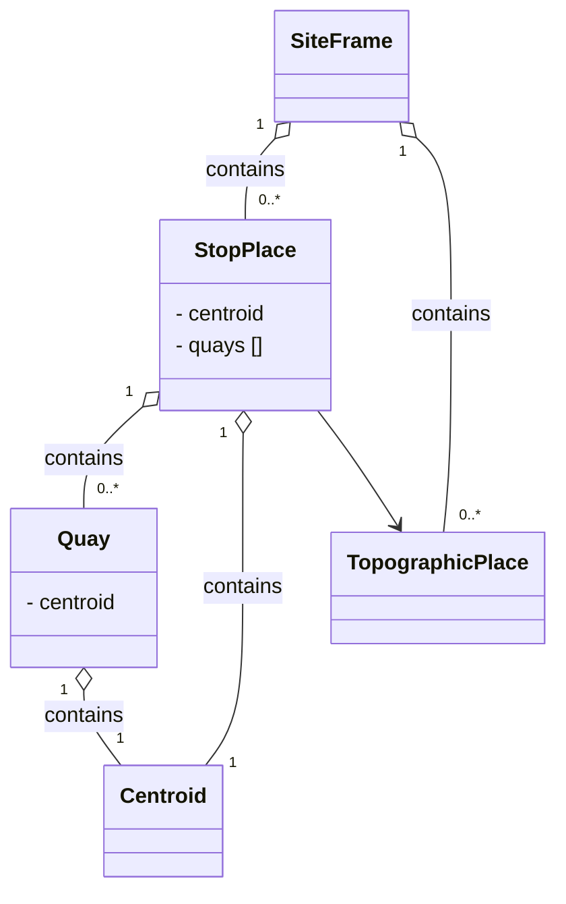

# Site Frame
In this chapter:

- [SiteFrame](#siteframe)
- [StopPlace](#stopplace)
- [Quay](#quay)
- [TopographicPlace](#topographicplace)
- [Centroid](#centroid)
- [AccessibilityAssessment](#accessibilityassessment)

## SiteFrame
*→ [Glossary definition](A4_annex_glossary.md#siteframe)*

### Purpose
A `SiteFrame` contains the physical infrastructure model for public transport — `StopPlace`s, `Quay`s, and topographic context. It defines the spatial elements that passengers interact with and that other frames reference for stop assignments.


*Figure: Elements in SiteFrame*

### Contained Elements

- `StopPlace`s – stations and stops 
  - `Quay`s - platforms where passengers can board or alight from a vehicle
- `TopographicPlace`s - geographical and administrative area context for stops
- Not currently modelled: entrances, levels, equipments, paths, accessibility properties, points of interest

### Table
- [Swiss profile NeTEx definition](../site/tables/SiteFrame.md)

*→ [General NeTEx definition ](../xcore/netex/elements/SiteFrame.html)*

### Example
- [Example snippet](../site/xml-snippets/SiteFrame.xml)

*→ [Template](./templates/SiteFrame.xml)*

### Frame Relationships
`SiteFrame` is independent of other frames but provides the physical stop infrastructure that `ServiceFrame` references through `PassengerStopAssignments`. `TimetableFrame` indirectly depends on `SiteFrame` through the `ServiceJourneyPattern` stop sequence. `SiteFrame` is typically wrapped in a `CompositeFrame` within a `PublicationDelivery`.

## StopPlace
*→ [Glossary definition](A4_annex_glossary.md#stopplace)*

### Purpose
A named physical or virtual location where passengers can board or alight from public transport, containing one or more `Quay`s.
Note that a `StopPlace` is a distinct concept from the representation of the stop in a timetable – the `ScheduledStopPoint`. The two can be connected using a `PassengerStopAssignment`. 


### Table
- [Swiss profile NeTEx definition](../site/tables/StopPlace.md)

*→ [General NeTEx definition ](../xcore/netex/elements/StopPlace.html)*

### Example
- [Example snippet](../site/xml-snippets/StopPlace.xml)

*→ [Template](./templates/StopPlace.xml)*

### Usage Notes
- All `StopPlace`s in Switzerland are identifiable by both a DIDOK number and a SLOID. DIDOK number are under the responsibility of the Department of Transport (BAV). It is possible that in the future the BAV will also regulate “Haltepunkte” and “Haltekanten” and, therefore, the identifiers of `Quay`s.
- Foreign `StopPlace`s may be mapped to Swiss DIDOK codes. 
- Meta-stations will have their own codes. In some cases these are added for operational or searching reasons. 
- `@id` needs to be kept stable between exports.
- DIDOK number placement: The DIDOK number is **not** transported as free text anywhere on `StopPlace`. It is placed in `privateCodes/PrivateCode` with `type="didok"`, **and** the same value must additionally be listed in the `KeyList` (`KeyValue` with matching `Key`). Both are required — the `PrivateCode` for direct lookup, the `KeyList` entry for generic key/value tooling.
- `ShortName` is not used on `StopPlace`. In particular, the DIDOK number must **never** be placed in `ShortName` — this was common practice under Profile 1.0 / HRDF-based exports and is explicitly discontinued under RV 2.0.
- `ValidBetween`: Every `StopPlace` carries a `ValidBetween` with a `FromDate`. Since `StopPlace` is infrastructure master data (not a timetable-period object), **no `ToDate` is set** — validity is open-ended until a future change is published.
- We have `Locale\TimeZone` set, when necessary. See also usage notes of `ServiceJourney`. Only used to calculate arrival and departure times.

#### Example: DIDOK number and validity on `StopPlace`
```xml
<StopPlace id="ch:1:StopPlace:8503000" version="1">
  <ValidBetween>
    <FromDate>2025-12-14T00:00:00</FromDate>
  </ValidBetween>
  <Name>Zürich HB</Name>
  <privateCodes>
    <PrivateCode type="didok">8503000</PrivateCode>
  </privateCodes>
  <keyList>
    <KeyValue>
      <Key>didok</Key>
      <Value>8503000</Value>
    </KeyValue>
  </keyList>
  <!-- Quays, Centroid, etc. -->
</StopPlace>
```

## Quay
*→ [Glossary definition](A4_annex_glossary.md#quay)*

### Purpose
A specific boarding or alighting position (platform, stand, bay) within a `StopPlace` where passengers physically meet vehicles. 

### Table
- [Swiss profile NeTEx definition](../site/tables/Quay.md)

*→ [General NeTEx definition ](../xcore/netex/elements/Quay.html)*

### Example
- [Example snippet](../site/xml-snippets/Quay.xml)

*→ [Template](./templates/Quay.xml)*

### Usage Notes
- In standard NeTEx, a `Quay` may serve one or more `VehicleStoppingPlace`s and be associated with one or more `StopPoint`s. The Swiss profile does not currently model that.
- A `Quay` may contain other sub `Quay`s. A child `Quay` must be physically contained within its parent `Quay`.  Furthermore: 
  - A nested `Quay` is always physically contiguous with its parent and so has the same accessibility characteristics 
as its parent. 
  - Nested `Quay`s should not be used to mark individual positions on a platform – `BoardingPosition` serve this function. 
  - Nested `Quay`s and `AccessSpace`s must always be on the same `Level` as their parent (not currently modeled).
- If the SLOID for platforms is not unique, it will be formed according to the schema:
{StopPlace SLOID}_gen:{Quay SLOID}_pf:{Platform Code}.
- If no platform SLOID is available {StopPlace SLOID}_gen:missingSLOID_pf:{Platform Code*} will be used instead.
- >NB: Special characters in the track identifier will be replaced with a dot («.»), for example 21/22 → 21.22.
- `@id` needs to be kept stable between exports.


In the table below you will find an overview of the possible cases. For more information on SLOID, see [Swiss Location Identification (SLOID)  öv-info.ch](https://www.oev-info.ch/de/datenmanagement/swiss-identification-public-transport-sid4pt/swiss-location-identification-sloid "https://www.oev-info.ch/de/datenmanagement/swiss-identification-public-transport-sid4pt/swiss-location-identification-sloid").

| Case | id | sloid in Key/Value, PrivateCode |
| -- | --|--|
| Unique track sloid | ch:1:sloid:7000:6:32 | ch:1:sloid:7000:6:32 |
| Non-unique track sloid | ch:1:sloid:7000_gen:ch:1:sloid:7000:0:349752_pf:2A-D | ch:1:sloid:7000:0:349752 |
| Non-unique SLOID with special characters "11/12" | ch:1:sloid:6206_gen:ch:1:sloid:6206:0:11_pf:11.12 | ch:1:sloid:6206:0:11 |
| non platform SLOID | ch:1:sloid:1102381_gen:missingSLOID_pf:1 | |
| No SLOID (abroad) | 8029701_gen:missingSLOID_pf:1 | |

*Table: SLOID and id in NeTEx*

`Quay`s are mapped with the following resolution: 
- No hierarchy between the different definitions of quays is foreseen at the moment 
- All combinations between sectors of the same quay are considered as independent quays. 
- Combinations of several quays are considered as independent quays. 

Further notes:
- In the future we intend to also include `Quay`s that remain unused by the regular timetable - this will alllow to properly handle real-time data that may refer to such "unused" `Quay`s.
- Atlas does model the hierarchy of the quays.

## TopographicPlace
*→ [Glossary definition](A4_annex_glossary.md#topographicplace)*

### Purpose
A named geographic area such as a city, municipality, county, or region - used to provide spatial context for `StopPlace`s, for example when interactively searching for the origin or destination of a trip.


### Table
- [Swiss profile NeTEx definition](../site/tables/TopographicPlace.md)

*→ [General NeTEx definition ](../xcore/netex/elements/TopographicPlace.html)*


### Example
- [Example snippet](../site/xml-snippets/TopographicPlace.xml)

*→ [Template](./templates/TopographicPlace.xml)*

### Usage Notes
- The `TopographicPlace` represent the cantons and communes in Switzerland. Each `StopPlace` should reference the `TopographicPlace` representing its canton.  
- `@id` needs to be kept stable between exports.


## Centroid

### Purpose
It provides precise geographic coordinates (WGS84) of a central reference point representing a single point or an area such as a `Quay`or a `StopPlace`. 

### Table
- [Swiss profile NeTEx definition](../site/tables/Centroid.md)

*→ [General NeTEx definition ](../xcore/netex/elements/Centroid.html)*

### Example
- [Example snippet](../site/xml-snippets/Centroid.xml)

*→ [Template](./templates/Centroid.xml)*

### Usage Notes
- The `Centroid` always contains a location. 
- The main coordinates are given as WGS84.
- Required accuracy 4+ decimal positions.
- The Swiss coordinates are added as well, when available (for Swiss stops). The format is LV95. For imports they are not needed, however.
- INFO+ will not use the master data from NeTEx imports, it will rely on the Atlas master data for all Swiss coordinates. INFO+ will, however, use the imported location data of foreign places without DIDOK numbers. 
- no `@id`


## AccessibilityAssessment
*→ [Glossary definition](A4_annex_glossary.md#accessibilityassessment)* 

### Purpose

An assessment of the usability by passengers with specific needs, for example, those needing wheelchair access, step-free access or for the visually or the auditorily impaired.


### Table
- [Swiss profile NeTEx definition](../site/tables/AccessibilityAssessment.md)

*→ [General NeTEx definition ](../xcore/netex/elements/AccessibilityAssessment.html)*

### Example
- [Example snippet](../site/xml-snippets/AccessibilityAssessment.xml)

*→ [Template](./templates/AccessibilityAssessment.xml)*


### Usage Notes

In case of `StopPlace` or `Quay`, EPIAP uses the following interpretation: 
`MobilityImpairedAccess` set to `true` means:
* `WheelchairAccess` `true`
* `StepFreeAccess` `true`
* `VisualSignsAvailable` `true` (only for railway stations)
* `TactileGuidanceAvailable` `true`

#### Interpretation of `AccessibilityLimitation`:

We apply a slightly stricter interpretation than the current version of EPIAP. The information that can be conveyed to the passengers thus becomes more useful and exporting the data to foreign systems is unproblematic. The additional constraints are [marked in brackets].

|                                                 |                                                                                                                                                                                                                                                                                                                                                                                                                                                                                                                                 |
|-------------------------------------------------|---------------------------------------------------------------------------------------------------------------------------------------------------------------------------------------------------------------------------------------------------------------------------------------------------------------------------------------------------------------------------------------------------------------------------------------------------------------------------------------------------------------------------------|
| `WheelchairAccess`                              | 1.    `StepFreeAccess` [including `EscalatorFreeAccess`] from an accessible entrance (see next row).<br>2.    The stop / platform is sufficiently wide to make a turn with a wheelchair when entering / leaving the vehicles that usually stop at this stop / platform (depending on the available / needed tools for entering / leaving the vehicle).<br>3.    If boarding trains requires boarding assistance, onsite assistance is available.                                                                                |
| `StepFreeAccess`                                | 1.    A step-free route is an obstacle-free / barrier free [and `EscalatorFreeAccess`] route that meets the needs of mobility impaired persons. Changes in level are avoided or, when they cannot be avoided, they are bridged via ramps or lifts (compliant with PRM TSI).<br>2.    The platform or stop is accessible without steps from the surrounding area (footpaths).<br><br>A platform which has `StepFreeAccess` without `WheelchairAccess` (==`false`) may be not sufficiently wide to make a turn with a wheelchair. |
| `StairFreeAccess`                               | A stair-free route. Single steps allowed, escalators allowed.                                                                                                                                                                                                                                                                                                                                                                                                                                                                   |
| `LevelAccessIntoVehicle`                        | Whether the platform is high enough and gap is small enough for level access into vehicle.<br><br>At least at a designated wheelchair door position the gap between platform and vehicle floor (of level access vehicle) does not exceed 75 mm measured horizontally and 50 mm measured vertically including sliding step (according to PRM TSI).                                                                                                                                                                               |
| `EscalatorFreeAccess` (not included in profile) | Reachable without using an escalator.                                                                                                                                                                                                                                                                                                                                                                                                                                                                                           |
| `LiftFreeAccess` (not included in profile)      | Reachable without using an elevator.                                                                                                                                                                                                                                                                                                                                                                                                                                                                                            |
| `RampFreeAccess`                                | 1.   Reachable without using a ramp that doesn't fit the [UN Design Considerations](https://www.un.org/esa/socdev/enable/designm/AD2-01.htm) (for instance, because they are too steep or a landing is missing in case of a ramp of more than 10 m).<br>2.    [The route provides `WheelchairAccess`]. **TODO** OK? A lesser constraint would be `StepFreeAccess`, but the principal (or only?) use case seems to be unassisted wheelchairs.                                                                                    |
| `AudibleSignalsAvailable`                       | Whether audible signals for the visually impaired are present.                                                                                                                                                                                                                                                                                                                                                                                                                                                                  |
| `VisualSignsAvailable`                          | 1.   PRM TSI: visual information as signposting, pictograms and dynamic information. <br>2.    [Largely language independent, also suited for passengers from foreign cultures.] **TODO** OK or wrong?                                                                                                                                                                                                                                                                                                                          |
| `TactileGuidanceAvailable`                      | Whether the object has tactile guidance (for the visually impaired).<br>PRM TSI: obstacle-free route to each Quay for the visually impaired passengers equipped with tactile information.  <br>For bus- and tram stops:  <br>1.  Groundsurfaceindicator (at location first door) and/or full-length guideline (for boarding at all entrances)<br>2.   Tactile guideline or boarding position connected to a (natural) guideline in the environment                                                                              |

#### Remarks `RampFreeAccess`

* Note that `RampFreeAccess` may very well include ramps - provided their slopes are only moderate or they have landing / rest areas.
* `RampFreeAccess`is a stronger form of `WheelchairAccess` excluding steeper slopes.


#### Limitations of AccessibilityAssessment

* If, e.g., `WheelchairAccess` or `StairFreeAccess` requires using a lift, the `AccessibilityAssessment` does not convey this information.
* According to EPIAP definitions, a quay with, e.g., `WheelchairAccess` means that there is at least one entrance from which it is reachable. It may be that `WheelchairAccess` only works from a secondary entrance, not from the main entrance.

Such information can be encoded using `SitePathLink`s and `PathJunction`s that describe a routing network including accessibility and location data.

#### Entrances related to AccessibilityAssessment
* All `AccessibiltyLimitation`s (`StepFreeAccess` etc.) relate to a complete path from an "accessible" `StopPlaceEntrance` with `DroppedKerb=true` and `DropOffPointClose=true`. 


