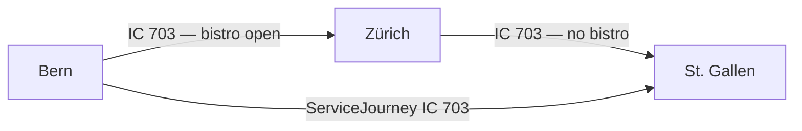

# Journey Parts

## Overview

A `JourneyPart` is a subsection of a `ServiceJourney` that differs from the rest of the journey in at least one relevant characteristic — such as a different train number, operator, or on-board facilities. The `ServiceJourney` as a whole still runs from start to finish; `JourneyPart`s subdivide it into meaningful segments for passenger information or operational purposes.

**When to use:** When the on-board service changes along a `ServiceJourney` (e.g. bistro available only on part of the route), or for a direct carriage (Kurswagen) that is pulled by different trains on different sections.



## Mapping between HRDF and NeTEx

| HRDF | NeTEx RG1 | NeTEx RG2 | Use Case |
|------|-----------|-----------|----------|
| `[attribut]` per Teilstrecke | `JourneyPart` | `JourneyPart` | Change of on-board facilities |
| `*KW` / `*KWZ` | – | `JourneyPart` with `PurposeOfJourneyPartition:DirectCarriage`, one per `*KWZ` | Direct carriage (Kurswagen) |

## Use Cases in the Swiss Profile

### 1. Change of on-board facilities (`PurposeOfJourneyPartition:FacilityChange`)

**When to use:** When a service (e.g. bistro, wifi) is only available on part of the route.

> In the example **IC 703 Bern – St. Gallen**, the bistro is open between Bern and Zürich (05:29–06:28) and again between Zürich and Wil SG (06:57–07:52), but not on the full journey.

```xml
<ServiceJourney id="ch:1:ServiceJourney:703" version="1">
  <!-- ... passingTimes ... -->
  <parts>
    <JourneyPart id="ch:1:JourneyPart:703-bistro-1" version="1">
      <FromStopPointRef ref="ch:1:sloid:7000:4:7" version="1"/>
      <ToStopPointRef ref="ch:1:sloid:218:7" version="1"/>
      <StartTime>05:29:00</StartTime>
      <StartTimeDayOffset>0</StartTimeDayOffset>
      <EndTime>06:28:00</EndTime>
      <EndTimeDayOffset>0</EndTimeDayOffset>
      <PurposeOfJourneyPartitionRef ref="ch:1:PurposeOfJourneyPartition:FacilityChange" version="1"/>
      <facilities>
        <ServiceFacilitySetRef ref="ch:1:ServiceFacilitySet:bistro-open" version="1"/>
      </facilities>
    </JourneyPart>
    <JourneyPart id="ch:1:JourneyPart:703-bistro-2" version="1">
      <FromStopPointRef ref="ch:1:sloid:3000:501:33" version="1"/>
      <ToStopPointRef ref="ch:1:sloid:6302:1" version="1"/>
      <StartTime>06:57:00</StartTime>
      <StartTimeDayOffset>0</StartTimeDayOffset>
      <EndTime>07:52:00</EndTime>
      <EndTimeDayOffset>0</EndTimeDayOffset>
      <PurposeOfJourneyPartitionRef ref="ch:1:PurposeOfJourneyPartition:FacilityChange" version="1"/>
      <facilities>
        <ServiceFacilitySetRef ref="ch:1:ServiceFacilitySet:bistro-open" version="1"/>
      </facilities>
    </JourneyPart>
  </parts>
</ServiceJourney>
```
- [Example](./examples/08_NeTEX_CH_Bern_Olten_ZuerichHB_Winterthur_StGallen_with_Facilities.xml)

### 2. Direct carriage (`PurposeOfJourneyPartition:DirectCarriage`)

**When to use:** For a direct carriage (Kurswagen): a coach group that is pulled by different trains on different sections. See [uc08 Direct carriages](uc08_kurswagen.md).

The coach group is one complete `ServiceJourney` from its first to its last stop. It contains one `JourneyPart` per pulling train, i.e. one per HRDF `*KWZ` line:

- `ParentJourneyRef` references the `ServiceJourney` of the pulling train.
- `FromPointInPatternRef` / `ToPointInPatternRef` delimit the section within the `ServiceJourneyPattern` of the pulling train. This can be a sub-range, e.g. if the pulling train continues after the coach group has been detached.
- `TrainNumberRef` is the train number of the pulling train.
- `StartTime` / `EndTime` with the day offsets give the time bounds of the section.
- `JourneyPartCoupleRef` is not used.

The `ServiceJourney` of the coach group lists the train numbers of all pulling trains in `trainNumbers`, in the order of the sections.

> In the example **direct carriage 37 Zürich HB – Bremen Hbf**, the coach group is pulled by train 472 (Zürich HB – Basel Bad Bf), train 470 (Basel Bad Bf – Hannover Hbf; 470 continues to Hamburg-Altona) and train 2746 (Hannover Hbf – Bremen Hbf).

```xml
<ServiceJourney id="ch:1:ServiceJourney:KW37" version="1" responsibilitySetRef="ch:1:ResponsibilitySet:DB">
  <!-- ... -->
  <trainNumbers>
    <TrainNumberRef ref="ch:1:TrainNumber:472" version="1"/>
    <TrainNumberRef ref="ch:1:TrainNumber:470" version="1"/>
    <TrainNumberRef ref="ch:1:TrainNumber:2746" version="1"/>
  </trainNumbers>
  <parts>
    <!-- ... part 1: train 472 ... -->
    <JourneyPart id="ch:1:JourneyPart:KW37:2" version="1">
      <Description lang="de">Kurswagen 37 am Zug 470, Basel Bad Bf - Hannover Hbf</Description>
      <ParentJourneyRef ref="ch:1:ServiceJourney:470" version="1"/>
      <TrainNumberRef ref="ch:1:TrainNumber:470" version="1"/>
      <FromPointInPatternRef ref="ch:1:ServiceJourneyPattern:470:1" version="1"/>
      <ToPointInPatternRef ref="ch:1:ServiceJourneyPattern:470:2" version="1"/>
      <StartTime>23:40:00</StartTime>
      <StartTimeDayOffset>0</StartTimeDayOffset>
      <EndTime>06:12:00</EndTime>
      <EndTimeDayOffset>1</EndTimeDayOffset>
      <PurposeOfJourneyPartitionRef ref="ch:1:PurposeOfJourneyPartition:DirectCarriage" version="1"/>
    </JourneyPart>
    <!-- ... part 3: train 2746 ... -->
  </parts>
</ServiceJourney>
```
- [Example](./examples/21_NeTEx_CH_Kurswagen_Zuerich_Bremen.xml)

### 3. Change of ProductCategoryRef
We will do this with `"ch:1:PurposeOfJouryneyPartition:TypeOfProductCategoryChange"` 

> *LATER* Example

### 4. Change of train number — NOT USED in the Swiss profile

**Status:** This use case is intentionally **not implemented** via `JourneyPart` in the Swiss profile.

Although passenger displays may show a train number change as if it were a single continuous journey, 
in the underlying data this is always modeled as **two separate `ServiceJourney`s linked via a 
`ServiceJourneyInterchange`** (suppressed in passenger-facing presentation). See 
[uc01 Durchbindung](uc01_durchbindung.md).

This concerns a train that operates under different train numbers on different sections of the same `ServiceJourney`. It does not concern direct carriages, where `TrainNumberRef` in the `JourneyPart` names the pulling train (see above).

### 5. Splitting and Joining
`JourneyPart` together with `CoupledJourney`could be used for a different modeling of joining and splitting (see [relevant use case](uc02_joining_splitting.md)).
However, we currently won't do that.

### 6. Integrating data from different sources to have something to load into a trip planner in international travel

A `ServiceJourney` may exist in the Swiss system only up to the first commercial stop abroad and completely but with less information in the Austrian system. To make sure that real-time data is easily applied the aggregated NeTEx timetable may still wish to keep the original delivered `ServiceJourney`. The relevant parts are then also modeled with `JourneyPart` and `CoupledJourney`. We won't do this either. But we study this for some international projects we have on aggregation of timetables. 

### 7. Notice only for a part of the ServiceJourney
We don't use `JourneyPart` for this. `NoticeAssignment` can be valid only for a part of the `ServiceJourney` (`StartPointInPatternRef` and `EndPointInPatternRef`).


### Table
- [Swiss profile NeTEx definition](../site/tables/JourneyPart.md)

*→ [General NeTEx definition ](../xcore/netex/elements/JourneyPart.html)*

### Example
- [Example snippet](../site/xml-snippets/JourneyPart.xml)

*→ [Template](./templates/JourneyPart.xml)*

## Usage Notes

- `JourneyPart`s are nested directly within the `ServiceJourney` under `<parts>`.
- For a facility change, `FromStopPointRef` / `ToStopPointRef` reference `ScheduledStopPoint`s of the `ServiceJourney` itself — a `JourneyPart` cannot introduce new stops.
- For a direct carriage, `FromPointInPatternRef` / `ToPointInPatternRef` reference points in the `ServiceJourneyPattern` of the pulling train given in `ParentJourneyRef`.
- A `ServiceFacilitySet` on a `JourneyPart` is valid for this part only.
- `JourneyPartCouple` is **not used** in the Swiss profile, neither for splitting and joining (use `ServiceJourneyInterchange`, see [uc02 Joining and splitting](uc02_joining_splitting.md)) nor for direct carriages.
- `JourneyPart` may become relevant for train composition (Wagenreihung) data in a future version of the profile. See [uc15 Formations](uc15_formations.md).

## Related use cases

- [uc02 Joining and splitting](uc02_joining_splitting.md)
- [uc03 Transfers](uc03_transfers.md)
- [uc08 Direct carriages](uc08_kurswagen.md)
- [uc15 Formations](uc15_formations.md)
