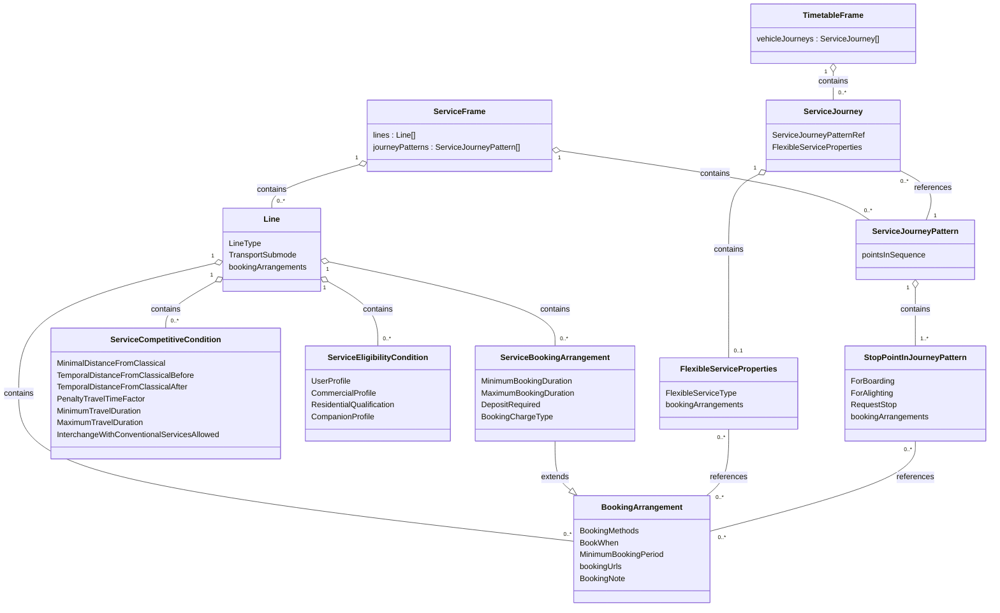
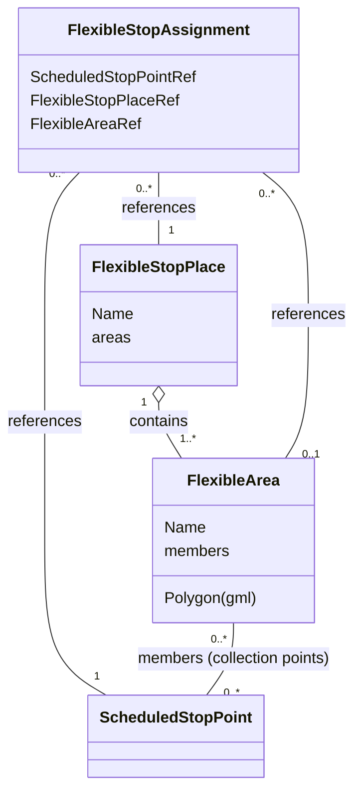

# Use Case: Demand Responsive Traffic (DRT)


>NOTE: Work in progress. We still have to update some things here. Currently, this is not yet finalised.

>NOTE: `ServiceCompetitiveCondition`, `ServiceEligibilityCondition` and `ServiceBookingArrangement` in
>`Line/bookingArrangements` were introduced by the DRT extension of NeTEx
>([pull request #959](https://github.com/NeTEx-CEN/NeTEx/pull/959)).

In this chapter:
- [Overview](#overview)
- [Modelling Principles](#modelling-principles)
- [Line and LineType](#line-and-linetype)
- [Booking and Rules on the Line](#booking-and-rules-on-the-line)
- [BookingArrangement](#bookingarrangement)
- [ServiceBookingArrangement](#servicebookingarrangement)
- [ServiceCompetitiveCondition](#servicecompetitivecondition)
- [ServiceEligibilityCondition](#serviceeligibilitycondition)
- [FlexibleServiceProperties](#flexibleserviceproperties)
- [Request Stops](#request-stops)
- [Reservation as Service Facility](#reservation-as-service-facility)
- [Collection Points](#collection-points)
- [Service Areas](#service-areas)
- [Templates and Examples](#templates-and-examples)

## Overview

Demand responsive traffic (DRT, German: *On-Demand-Verkehr*, ODV) covers services that only run,
or only serve some stops, when passengers have booked or requested them.

The Swiss DRT types and their `LineType` are defined in the sheet *LineType* of the
[mapping table for NeTEx 2.0](media/Mappingtabellen_NeTEx_v2.0.xlsx):

*Table: Swiss DRT types*

| Remarks from the mapping table | LineType | TransportSubmode | Swiss DRT type |
|--------------------------------|----------|------------------|----------------|
| Fixed stops, operated on request. | `flexible` | `BusSubmode` `demandAndResponseBus` | 1 – Bedarfslinie |
| Combines fixed and flexible elements; passengers book individual trips, shared vehicle routing. | `mixedFlexibleAndFixed` | `BusSubmode` `demandAndResponseBus` | 2 – Anrufsammelverkehr |
| Flexible routing along a geographic corridor; stops constrained to the corridor. | `corridorService` | `BusSubmode` `demandAndResponseBus` | 3 – Richtungsband, örtlich disponierter Bus |
| Area-wide service with time-based operating windows; time restriction via `AvailabilityCondition` / `Timeband`. | `freeAreaAreaWide` | `BusSubmode` `demandAndResponseBus` | 4 – Zeitbezogener Flächenverkehr |
| Fully area-wide, no fixed stops. | `freeAreaAreaWide` | `BusSubmode` `demandAndResponseBus` | 5 – Freier Flächenverkehr |

## Modelling Principles

A DRT offer is delivered with the same frames and elements as any other timetable. The
flexibility is expressed in these places:

- **Line:** every DRT service is a `Line` in the `ServiceFrame` with the `LineType` of its Swiss
  DRT type and `BusSubmode` `demandAndResponseBus`, see [Line and LineType](#line-and-linetype).
- **Line/bookingArrangements:** holds the booking conditions and the rules of the service, see
  [Booking and Rules on the Line](#booking-and-rules-on-the-line).
- **ServiceJourney:** a single on-demand journey has `FlexibleServiceProperties` referencing the
  `BookingArrangement` of the `Line` (example 04), see
  [FlexibleServiceProperties](#flexibleserviceproperties).
- **StopPointInJourneyPattern:** a request stop has `RequestStop` `true` and a request method; a
  flexible stop references the `BookingArrangement`, see [Request Stops](#request-stops).
- **ServiceFacilitySet and Notice:** reservation offers from HRDF are delivered as facility and
  `Notice`, see [Reservation as Service Facility](#reservation-as-service-facility).
- **TypeOfPlace:** stops are typed as `drtCollectionPoint` or `regularStop`, see
  [Collection Points](#collection-points).
- **FlexibleStopPlace and FlexibleStopAssignment:** the service area of the types 3 to 5, see
  [Service Areas](#service-areas).

`Line` replaces `FlexibleLine` (`forbidden` in the [ServiceFrame template](./templates/ServiceFrame.xml)),
and `LineType` replaces `TypeOfFlexibleService` (mapping table, sheet *LineType*).


*Figure: Elements used for DRT*

## Line and LineType
*→ [Glossary definition](A4_annex_glossary.md#line)*

### Purpose
General rules for `Line` are in [Service Frame](06_service.md#line). `LineType` is `expected`
([Line template](./templates/Line.xml)); its values are defined in the mapping table.

### Usage Notes
- A DRT line gets the `LineType` of its Swiss DRT type (see [Overview](#overview)) and
  `BusSubmode` `demandAndResponseBus`.
- `fixed` is the default for all non-DRT lines. If `LineType` is omitted, `fixed` is assumed.
- The values `mainRouteWithFlexibleEnds`, `flexibleAreasOnly`, `hailAndRideSections`,
  `fixedStopAreaWide` and `mixedFlexible` are not used in the Swiss profile.

### Example

```xml
<Line id="ch:1:slnid:1026470" version="1" responsibilitySetRef="ch:1:ResponsibilitySet:BLT">
  <!-- ... -->
  <TransportMode>bus</TransportMode>
  <TransportSubmode>
    <BusSubmode>demandAndResponseBus</BusSubmode>
  </TransportSubmode>
  <!-- ... -->
  <LineType>flexible</LineType>
  <TypeOfProductCategoryRef ref="ch:1:TypeOfProductCategory:B" version="1"/>
  <bookingArrangements>
    <BookingArrangement id="ch:blt:generated:BOOK:29013" version="1">
      <BookingMethods>mobileApp</BookingMethods>
      <BookWhen>advanceOnly</BookWhen>
      <BookingNote>Einstieg nur auf Voranmeldung mind. 30 Min. vor der Fahrt.</BookingNote>
    </BookingArrangement>
  </bookingArrangements>
</Line>
```

## Booking and Rules on the Line

### Purpose
`Line/bookingArrangements` holds four kinds of elements:

*Table: Elements in Line/bookingArrangements*

| Element | Describes |
|---------|-----------|
| `BookingArrangement` | How to book. |
| `ServiceBookingArrangement` | How to book, with additional elements for booking duration and charges. |
| `ServiceCompetitiveCondition` | What the service may do and may not do in relation to classical public transport. |
| `ServiceEligibilityCondition` | Who can use the service. |

### Usage Notes
- Several `ServiceEligibilityCondition`s are combined with OR (e.g. "senior **or** child"). This
  may require splitting a service.
- `Line/bookingArrangements` is of type `serviceBookingArrangements_RelStructure` and can hold all
  four elements. `bookingArrangements` in `ServiceJourney`,
  `FlexibleServiceProperties` and `StopPointInJourneyPattern` stays
  `bookingArrangements_RelStructure`: only `BookingArrangement` or `BookingArrangementRef`.
  `ServiceBookingArrangement`, `ServiceCompetitiveCondition` and `ServiceEligibilityCondition` are
  therefore only possible in `Line/bookingArrangements`.
- The `bookingArrangements` of the `Line` are valid for the whole `Line`; a lower level supersedes a
  higher level (XSD documentation of `Line/bookingArrangements`).

## BookingArrangement

### Purpose
Describes how, when and where a DRT service is booked.

*Table: Elements of BookingArrangement*

| Element | Values / type |
|---------|---------------|
| `BookingContact` | Contact details of the booking office. |
| `BookingMethods` | `callDriver`, `callOffice`, `online`, `phoneAtStop`, `text`, `mobileApp`, `atOffice`, `none`, `other` (list) |
| `BookingAccess` | `public`, `authorisedPublic`, `staff`, `other` |
| `BookWhen` / `BuyWhen` | `advanceOnly`, `untilPreviousDay`, `dayOfTravelOnly`, `advanceAndDayOfTravel`, `timeOfTravelOnly`, `subscriptionChargeMoment`, `other` |
| `LatestBookingTime` | Time |
| `MinimumBookingPeriod` / `MaximumBookingPeriod` | Duration |
| `BookingUrl` | URI |
| `bookingUrls` | `BookingUrl` (URI), `BookingDeepUrl` (`Endpoint`, `parameterDescriptions`) or `BookingService` (`Endpoint`, `EndpointVersion`, `BookingServiceType`, `SupportedSteps`); at least one entry. |
| `BookingNote` | Text |

`BookingServiceType`: `tomp`, `osdm`, `bob`, `trias`, `ojp`, `other`. `SupportedSteps` (list):
`tripPlanning`, `pricing`, `availability`, `booking`, `reservation`, `fulfillment`, `full`, `other`.

### Usage Notes
- From the HRDF conversion only a `BookingNote` can be passed at the moment. With native NeTEx
  handling more information can be transferred
  ([ServiceJourneyPattern template](./templates/ServiceJourneyPattern.xml)).
- In a `ServiceJourneyPattern`, the `BookingArrangement` is referenced with
  `BookingArrangementRef`; an inline `BookingArrangement` is `ignored`.
- `BookingArrangement` is still needed even though `ServiceBookingArrangement` contains all its
  elements: `ServiceJourney`, `FlexibleServiceProperties` and `StopPointInJourneyPattern` can only
  hold a `BookingArrangement` or a `BookingArrangementRef` (see
  [Booking and Rules on the Line](#booking-and-rules-on-the-line)).

## ServiceBookingArrangement

### Purpose
Contains the elements of `BookingArrangement` and additionally `MinimumBookingDuration`,
`MaximumBookingDuration`, `DepositRequired` and `BookingChargeType` (`fullAmount`,
`blockFullAmountOnCard`, `deposit`, `none`, `other`).

## ServiceCompetitiveCondition

### Purpose
Describes restrictions of the DRT service towards classical public transport. Besides `Name` and
`Description` it contains **exactly one** of three groups (choice in the XSD).

*Table: Elements of ServiceCompetitiveCondition*

| Group | Element | Meaning |
|-------|---------|---------|
| Distance | `transferRestrictions` / `routingConstraintZones` | Restrictions towards other services. If not set, the rules apply in general. |
| Distance | `MinimalDistanceFromClassical` | Distance in metres to the line/service or classical public transport in general: the minimum walking distance from the next `StopPlace` of classical public transport. |
| Distance | `TemporalDistanceFromClassicalBefore` / `TemporalDistanceFromClassicalAfter` | Temporal distance to the service/transfer in the routing constraint or classical public transport in general, before / after the departure at a reasonably nearby stop. |
| Dominance | `PenaltyTravelTimeFactor` / `PenaltyTransferTimeFactor` / `WalkTimeFactor` | Factors for the comparison with classical public transport (default `1.0`). |
| Dominance | `PenaltyTravelTimeOffset` | Offset in the calculation of the dominance (default `PT0S`). |
| Dominance | `MinimumTravelDuration` / `MaximumTravelDuration` | Minimum (default `PT0S`) and maximum travel duration allowed for the service. |
| Interchange | `InterchangeBetweenFlexibleServicesAllowed` | Default `false`. |
| Interchange | `InterchangeWithConventionalServicesAllowed` | Default `false`. |

### Example

```xml
<ServiceCompetitiveCondition id="ch:1:ServiceCompetitiveCondition:1" version="1">
  <MinimalDistanceFromClassical>200</MinimalDistanceFromClassical>
  <TemporalDistanceFromClassicalBefore>PT15M</TemporalDistanceFromClassicalBefore>
</ServiceCompetitiveCondition>
```

## ServiceEligibilityCondition

### Purpose
Describes who can use the service. Each condition contains exactly one of `UserProfile`,
`CommercialProfile`, `ResidentialQualification` or `CompanionProfile`.

### Example

```xml
<ServiceEligibilityCondition id="ch:1:ServiceEligibilityCondition:1" version="1">
  <UserProfile id="ch:1:UserProfile:1" version="1">
    <MinimumAge>65</MinimumAge>
  </UserProfile>
</ServiceEligibilityCondition>
```

## FlexibleServiceProperties
*→ [Glossary definition](A4_annex_glossary.md#flexibleserviceproperties)*

### Purpose
Additional characteristics of a flexible service on a single `ServiceJourney`; a service may be
partly fixed, partly flexible. Elements: `FlexibleServiceType` (`dynamicPassingTimes`,
`fixedHeadwayFrequency`, `fixedPassingTimes`, `notFlexible`, `other`), `CancellationPossible`,
`ChangeOfTimePossible` and `bookingArrangements`.

### Example
From [example 04](./examples/04_NeTEx_CH_DRT_Line_50.110.xml):

```xml
<ServiceJourney id="ch:blt:generated:SJ:29013:ODV" version="1" responsibilitySetRef="ch:1:ResponsibilitySet:BLT">
  <!-- ... -->
  <FlexibleServiceProperties id="ch:blt:generated:FSP:SJ:29013:ODV" version="1">
    <bookingArrangements>
      <BookingArrangementRef ref="ch:blt:generated:BOOK:29013" version="1"/>
    </bookingArrangements>
  </FlexibleServiceProperties>
</ServiceJourney>
```

## Request Stops

### Purpose
Request stops are set in the `StopPointInJourneyPattern` (see
[Service Frame](06_service.md#servicejourneypattern)). The mapping from HRDF is defined in the
sheet *Haltecode* of the mapping table:

*Table: Request stops (Bedarfshalt, HRDF `*A X`)*

| HRDF | ForAlighting | ForBoarding | RequestStop | Request method |
|------|--------------|-------------|-------------|----------------|
| Bedarfshalt | `true` | `true` | `true` | `BoardingRequestMethod` and `AlightingRequestMethod` |
| Bedarfshalt nur zum Einsteigen | `false` | `true` | `true` | `BoardingRequestMethod` |
| Bedarfshalt nur zum Aussteigen | `true` | `false` | `true` | `AlightingRequestMethod` |

### Usage Notes
- `StopUse` is `access`, at stations with BHFArt 3 `interchangeOnly`.
- A flexible stop references the `BookingArrangement` with `BookingArrangementRef`
  ([ServiceJourneyPattern template](./templates/ServiceJourneyPattern.xml), `optional`). The template uses
  it to mark that a stop is flexible.

## Reservation as Service Facility

Reservation offers from HRDF are delivered as `ServiceFacilitySet` and, where defined, as `Notice`
(sheet *Angebote* of the mapping table, see also [Service Facilities](uc04_service_facilities.md)).
Examples:

*Table: Reservation offers relevant for DRT*

| HRDF | Text | Facility | Notice |
|------|------|----------|--------|
| `BH` | Bedarfshalt nur auf telefonische Voranmeldung | `reservationsCompulsory`; `RequestStop` `true` in the call | yes |
| `RR` | Reservierung obligatorisch | `reservationsCompulsory` | – |
| `XR` | Einstieg nur nach telefonischer Voranmeldung | `reservationsCompulsory` | yes |
| `GR` | GRUPPEN: Reservierung obligatorisch | `groupsAllowedWithReservation` or `reservationsCompulsoryForGroups` | – |

## Collection Points

### Purpose
The Swiss profile distinguishes two types of stop place
([Resource Frame](09_resources.md#typesofplace)):

*Table: Types of stop place*

| `TypeOfPlace` | Name (de / en) | Meaning |
|---------------|----------------|---------|
| `regularStop` | Reguläre Haltestelle / Regular Stop | Regular stop from classic public transport. |
| `drtCollectionPoint` | Sammelpunkt / Collection Point | Irregular stop used in demand responsive transport. |

Both are defined as `TypeOfPlace` in the `ValueSet` `ch:1:ValueSet:TypesOfPlace` of the
`ResourceFrame`. The `ValueSet` is `expected` and must have these two entries
([TypesOfPlace template](./templates/TypesOfPlace.xml),
[ResourceFrame template](./templates/ResourceFrame.xml)).

The type is independent of `StopPlaceType`: `StopPlaceType` describes the kind of stop place
(e.g. `onstreetBus`, values in the sheet *StopPlaceType* of the
[mapping table](media/Mappingtabellen_NeTEx_v2.0.xlsx)), the `TypeOfPlace` says whether it is a
regular stop or a collection point.

### Example
In NeTEx, a `StopPlace` refers to its `TypeOfPlace` with `placeTypes/TypeOfPlaceRef` (directly after
`Centroid`):

```xml
<StopPlace id="ch:1:sloid:7000" version="1">
  <!-- ... -->
  <Name>Bern</Name>
  <Centroid>
    <!-- ... -->
  </Centroid>
  <placeTypes>
    <TypeOfPlaceRef ref="regularStop" version="1"/>
  </placeTypes>
  <!-- ... -->
  <StopPlaceType>railStation</StopPlaceType>
  <!-- ... -->
</StopPlace>
```

## Service Areas

### Purpose
The types 3 to 5 have a service area (Bediengebiet). Type 3 (corridor) is modelled as an area as
well. The modelling follows the Swiss area example in the NeTEx repository
(`examples/functions/drt/CH_DRT_Area_mybuxi.xml`), split between the two file types like the regular
stops:

*Table: Elements for service areas*

| Element | Frame | File type | Purpose |
|---------|-------|-----------|---------|
| `FlexibleStopPlace` with one `FlexibleArea` | `SiteFrame/flexibleStopPlaces` | `SITE_OFFER` | The area with its geometry. |
| `ScheduledStopPoint` | `ServiceFrame/scheduledStopPoints` | `NETWORK_OFFER` | Stands for the whole area in the `ServiceJourneyPattern`. |
| `FlexibleStopAssignment` | `ServiceFrame/stopAssignments` | `NETWORK_OFFER` | Links the `ScheduledStopPoint` to the `FlexibleStopPlace` and `FlexibleArea`, like `PassengerStopAssignment` for regular stops. |


*Figure: Service area*

### Table
- [Swiss profile NeTEx definition: FlexibleStopPlace](../site/tables/FlexibleStopPlace.md)
- [Swiss profile NeTEx definition: FlexibleStopAssignment](../site/tables/FlexibleStopAssignment.md)

*→ [General NeTEx definition](../xcore/netex/elements/FlexibleStopPlace.html)*

### Example

```xml
<FlexibleStopPlace id="ch:1:FlexibleStopPlace:myBuxi_Gotthardregion" version="1">
  <Name>myBuxi Gotthardregion</Name>
  <ShortName>31</ShortName>
  <TransportMode>bus</TransportMode>
  <areas>
    <FlexibleArea id="ch:1:FlexibleArea:myBuxi_Gotthardregion" version="1">
      <Name lang="de">myBuxi Gotthardregion</Name>
      <members>
        <ScheduledStopPointRef ref="ch:1:StopPlaceCollectionPoint:2-0-Gen" versionRef="1"/>
        <ScheduledStopPointRef ref="ch:1:StopPlaceCollectionPoint:3-0-Gen" versionRef="1"/>
      </members>
      <gml:Polygon gml:id="Area31" srsName="EPSG:4326">
        <gml:exterior>
          <gml:LinearRing>
            <gml:pos>8.6314774 46.7285658</gml:pos>
            <!-- ... -->
            <gml:pos>8.6314774 46.7285658</gml:pos>
          </gml:LinearRing>
        </gml:exterior>
      </gml:Polygon>
    </FlexibleArea>
  </areas>
</FlexibleStopPlace>
```

```xml
<FlexibleStopAssignment id="ch:1:FlexibleStopAssignment:myBuxi_Gotthardregion" version="1">
  <ScheduledStopPointRef ref="ch:1:DrtArea:myBuxi_Gotthardregion" versionRef="1"/>
  <FlexibleStopPlaceRef ref="ch:1:FlexibleStopPlace:myBuxi_Gotthardregion" versionRef="1"/>
  <FlexibleAreaRef ref="ch:1:FlexibleArea:myBuxi_Gotthardregion" versionRef="1"/>
</FlexibleStopAssignment>
```

*→ [FlexibleStopPlace template](./templates/FlexibleStopPlace.xml),
[FlexibleStopAssignment template](./templates/FlexibleStopAssignment.xml)*

### Usage Notes
- The geometry of the `FlexibleArea` is mandatory: either `gml:Polygon` or `gml:MultiSurface` (choice in the
  XSD), in EPSG:4326. The schematron does not check this, because the template annotations cannot express the
  choice and do not handle the `gml` namespace; the template marks it as `expected`.
- `members` is optional. It lists the collection points (`TypeOfPlace` `drtCollectionPoint`, see
  [Collection Points](#collection-points)) of the area, if the service has any. A service without fixed stops
  (type 5) has no `members`, only the geometry.
- `members` and the references in the `FlexibleStopAssignment` point into the other file type. They use
  `versionRef` instead of `version`: with `version`, the XSD key reference requires the referenced object in the
  same document.
- `HailAndRideArea` is not used.

## Templates and Examples

*Table: Templates relevant for DRT*

| Swiss profile definition | Template | Relevant content |
|--------------------------|----------|------------------|
| [ServiceFrame](../site/tables/ServiceFrame.md), [ServiceFrame_NETWORK_OFFER](../site/tables/ServiceFrame_NETWORK_OFFER.md) | [ServiceFrame](./templates/ServiceFrame.xml), [ServiceFrame_NETWORK_OFFER](./templates/ServiceFrame_NETWORK_OFFER.xml) | `Line` |
| [Line](../site/tables/Line.md) | [Line](./templates/Line.xml) | `LineType`, `TransportSubmode` |
| [ServiceJourneyPattern](../site/tables/ServiceJourneyPattern.md) | [ServiceJourneyPattern](./templates/ServiceJourneyPattern.xml) | `ForBoarding`, `ForAlighting`, `RequestStop`, `StopUse`, `BookingArrangementRef` |
| [ServiceFacilitySet](../site/tables/ServiceFacilitySet.md) | [ServiceFacilitySet](./templates/ServiceFacilitySet.xml) | Facilities, `GroupBookingFacility` |
| [Notice](../site/tables/Notice.md) | [Notice](./templates/Notice.xml) | Passenger information |
| [StopPlace](../site/tables/StopPlace.md) | [StopPlace](./templates/StopPlace.xml) | `StopPlaceType` |
| [FlexibleStopPlace](../site/tables/FlexibleStopPlace.md), [SiteFrame](../site/tables/SiteFrame.md) | [FlexibleStopPlace](./templates/FlexibleStopPlace.xml), [SiteFrame](./templates/SiteFrame.xml) | Service area (`FlexibleArea`) |
| [FlexibleStopAssignment](../site/tables/FlexibleStopAssignment.md) | [FlexibleStopAssignment](./templates/FlexibleStopAssignment.xml), [ServiceFrame_NETWORK_OFFER](./templates/ServiceFrame_NETWORK_OFFER.xml) | Link between `ScheduledStopPoint` and service area |
| [TypesOfPlace](../site/tables/TypesOfPlace.md), [ResourceFrame](../site/tables/ResourceFrame.md) | [TypesOfPlace](./templates/TypesOfPlace.xml), [ResourceFrame](./templates/ResourceFrame.xml) | `drtCollectionPoint`, `regularStop` |
| [AvailabilityCondition](../site/tables/AvailabilityCondition.md) | [AvailabilityCondition](./templates/AvailabilityCondition.xml) | `Timeband`s (time restriction of type 4) |

*Table: Examples relevant for DRT*

| Example | Content |
|---------|---------|
| [04_NeTEx_CH_DRT_Line_50.110](./examples/04_NeTEx_CH_DRT_Line_50.110.xml) | `BookingArrangement` on the `Line`, one on-demand journey with `FlexibleServiceProperties`. |
| [05_NeTEx_CH_DRT_Line_Dependent_On_Passengers_At_Start](./examples/05_NeTEx_CH_DRT_Line_Dependent_On_Passengers_At_Start.xml) | No reservation; passengers can only alight after the first stop (`ForBoarding` `false`), `Notice`. |

Further Swiss DRT examples are in the NeTEx repository under
[`examples/functions/drt/`](https://github.com/NeTEx-CEN/NeTEx/tree/v2.1-wip/examples/functions/drt).
